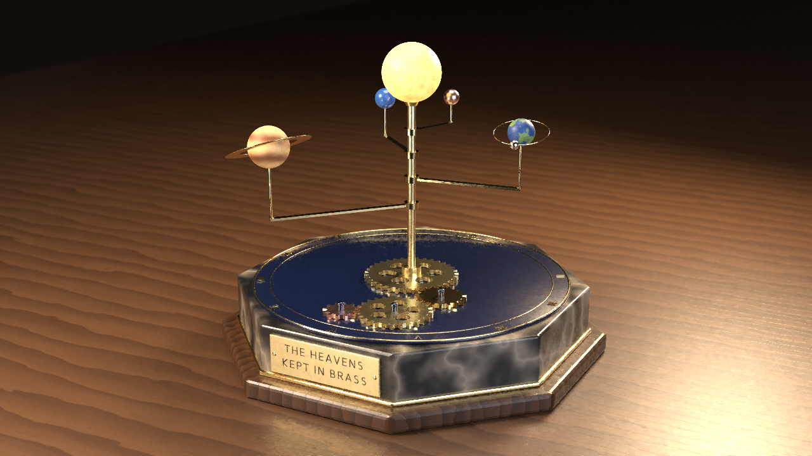
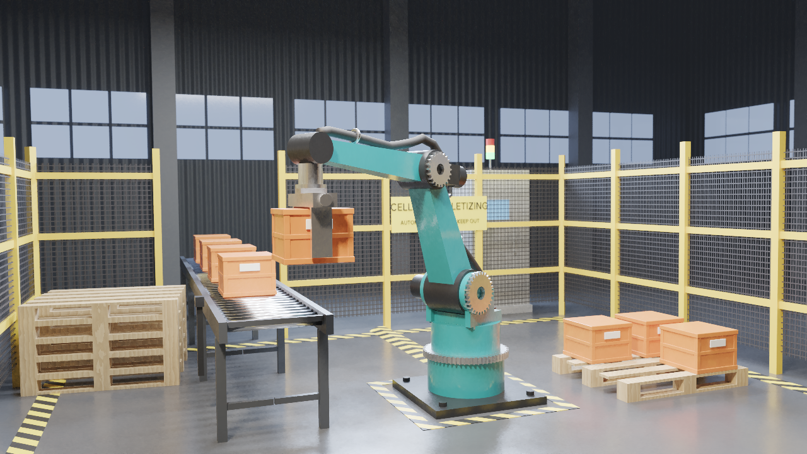
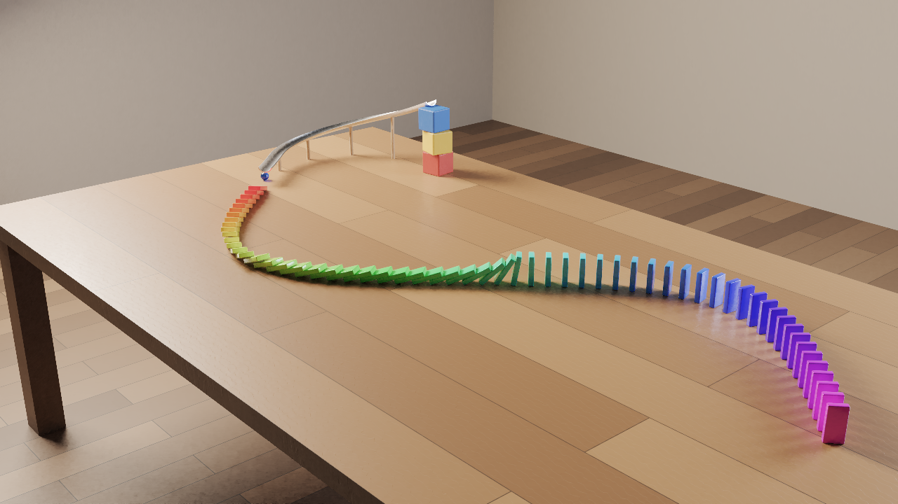

# 3D Editor

A collaborative, offline-capable 3D editor for the web, modeled on Blender's workflow, naming and
keymap. It covers mesh, curve and text modeling, modifiers, constraints, armatures with IK and
skinning, shape keys, particle scattering and collection instances, rigid-body physics,
procedural materials, a physical sky and mist, keyframe animation with drivers and F-curve
modifiers, and two renderers: real-time WebGL rasterization and a CPU path tracer that runs on
Web Workers in the browser or in render processes on the server.

The editor is an installable PWA that works offline and saves to your browser or to WebDAV. Every
change syncs live to all devices that have the project open. AI agents can build, animate and
render whole scenes through the MCP endpoint, and the browser and server report telemetry so the
editor can be improved from real usage.

> **Scope, honestly.** Blender is the product of three decades of work. This project implements a
> broad subset of its modeling, rigging, animation, simulation and rendering features (listed area
> by area in [docs/features.md](docs/features.md)) on an architecture where every action is an
> operator in one registry: about 260 operators, shared by menus, hotkeys, the JavaScript console
> and MCP agents. Several areas are simpler than in Blender: bones are posed from the Properties
> editor or by operators (there is no interactive Pose Mode, and no Edit Mode for curves or
> armatures in the viewport), particle systems are static scatters, physics covers rigid bodies
> only, the path tracer runs on CPUs only, and UV unwrapping projects charts instead of computing
> a conformal unwrap. Not implemented: geometry and shader node editors, the compositor, Grease
> Pencil, the video sequencer, cloth, soft body, fluid and smoke simulation, hair, motion
> tracking, Python scripting and add-ons.

## Highlights

- **Blender-style interface** – 3D viewport with header menus, toolbar (T), sidebar (N) and
  navigation gizmo; outliner with rows for modifiers, constraints, particle systems and rigid
  bodies; a Properties editor with Blender's tabs (Render, Output, Scene, World, Object,
  Modifiers, Particles, Physics, Object Constraints, Object Data, Material); timeline, dope sheet,
  UV editor, info log and JavaScript console; Layout, Modeling, Shading, Animation and Scripting
  workspaces; Blender's keymap (G/R/S with axis constraints and numeric input, Tab, Shift+A,
  Ctrl+P, Shift+Ctrl+C, I, F12, numpad views…), F3 operator search, _Adjust Last Operation_ and
  _Repeat Last_ (Shift+R).
- **Modeling** – mesh primitives and 21 procedural generators (terrain, rock, tree, bush, grass,
  building, stairs, fence, column, arch, table, chair, gear, spring, wheel, pipe…); Edit Mode
  with vertex/edge/face selection and mesh tools (extrude, inset, bevel, loop cut, subdivide,
  bridge, spin, merge, dissolve, symmetrize, separate…); Bezier, NURBS and poly curves with bevel,
  extrusion, fill and bevel objects; text objects with a built-in font; 22 modifier types,
  including Subdivision Surface, Boolean, Bevel, Array, Mirror, Screw, Solidify, Shrinkwrap,
  Curve and Armature; sculpt and vertex paint modes; UV projections.
- **Rigging and constraints** – armatures with bone chains, IK with pole targets, bone
  constraints, automatic (bone heat) and envelope weights, vertex groups, the Armature modifier
  with linear or dual-quaternion skinning, and shape keys; 16 object constraint types (Track To,
  Child Of, Follow Path, Copy and Limit constraints…) evaluated in dependency order, where
  constraints on a dependency cycle are skipped and reported.
- **Particles, instancing and physics** – collection instances; particle systems that scatter
  objects or collections over a surface (vertex group density, minimum distance, random size and
  rotation), drawn and rendered as instances; rigid bodies (active, passive or animated; seven
  collision shapes) with a cached, deterministic simulation that can be baked to keyframes.
- **Look development** – Principled-style materials (base color, metallic, roughness, IOR,
  transmission, emission, alpha, coat, sheen, normal maps) with image textures or procedural
  textures (noise, Voronoi, checker, gradient, wave, brick, marble, wood, magic) on six channels,
  and 33 material presets; point, sun, spot and area lights in Blender's units, with area light
  shapes; cameras with depth of field (rendered by the path tracer); a studio environment, an
  analytic sky with seven presets, and mist.
- **Rendering** – Wireframe, Solid, Material Preview and Rendered viewport shading (WebGL). F12
  renders with WebGL or with the path tracer (Principled BSDF, next-event estimation with
  multiple importance sampling, depth of field, sky and environment lighting, a denoiser, AgX,
  Filmic, ACES and Khronos PBR Neutral view transforms) on a pool of Web Workers; Ctrl+F12 renders
  the frame range to an animated PNG or GIF. The WebGL renders use the path tracer's light units
  and view transforms, so a quick preview has the brightness and look of the final render. The
  server path traces in render processes of its own for MCP agents and the REST API.
- **Animation** – keyframes on object, bone, material, light, camera, world, shape key and curve
  properties; Bezier, linear and constant interpolation; constant, linear and cyclic
  extrapolation; scripted drivers in a sandboxed Python-like expression language; F-curve
  modifiers (Noise, Stepped, Generator, Limits, Envelope); camera turntables and visual-transform
  baking; timeline and dope sheet.
- **Scene tools** – measure, ray cast and scene statistics; align, distribute, set dimensions,
  look at, drop to ground, snap to surface, array placement and scatter on surface.
- **Files** – import and export glTF 2.0 (`.glb`/`.gltf`), OBJ, STL and PLY. The glTF exporter
  writes the hierarchy, materials (procedural textures baked to images), cameras, lights,
  instances and the animation sampled per frame, with skins and morph targets.
  <!-- re-check: gltf-export (matched packages/core/src/io/gltf-export.ts on 2026-11-06) -->
- **Offline PWA** – installable, works without a network after the first visit.
- **Storage** – browser (IndexedDB) by default; WebDAV when configured (on the server or in the
  browser), with CRDT merge-saving so concurrent devices never overwrite each other.
- **Real-time collaboration** – every change syncs to all devices with the project open (Yjs
  CRDT over WebSockets, plus BroadcastChannel between tabs); presence avatars, remote selections,
  "follow" another user's view; per-user undo.
- **AI agents (MCP)** – a `/mcp` Streamable HTTP endpoint with 36 tools to manage projects,
  inspect scenes (`get_scene`, `get_object` and `get_mesh_data` report evaluated values and
  evaluation problems, `get_instances` where scattered instances are), run any operator
  (`run_operator`, or `batch` for many in one undo step), edit meshes,
  set materials, modifiers, keyframes and scene settings, import and export files, render images
  or animations (`render_image`, `render_animation` with contact sheets, GIF and APNG) and drive
  the live editor UI. [`scripts/mcp.mjs`](scripts/mcp.mjs) is a small CLI and module client. See
  [docs/mcp.md](docs/mcp.md) and the [guide for AI agents](docs/agent-guide.md).
- **Observability** – browser and server OpenTelemetry traces/metrics/logs, Prometheus
  `/metrics`, structured logs, health checks, and a Grafana dashboard. See
  [docs/observability.md](docs/observability.md).

## Examples

Each project in [`examples/`](examples) was built from scratch by an AI agent working only
through the MCP server, with the same tools any external agent gets. The build is reproducible:
run against a server, an example's `build.mjs` deletes and recreates its project, builds the
whole scene and writes its renders next to itself (`--export-only` writes the glTF export
`scene.glb` instead; each script's header lists its modes). Building a scene is quick; the
path-traced renders take most of the time. The [examples index](examples/README.md) describes
what each project shows, which editor features and MCP tools it uses, and how to rebuild it.

```bash
npm start &                                   # or any running server
MCP_URL=http://127.0.0.1:8080/mcp node examples/lighthouse-cove/build.mjs
```

| Final still                                                                                                                                                             | Project                                                                                                                                                                                                                                                                                                                                                                   |
| ----------------------------------------------------------------------------------------------------------------------------------------------------------------------- | ------------------------------------------------------------------------------------------------------------------------------------------------------------------------------------------------------------------------------------------------------------------------------------------------------------------------------------------------------------------------- |
| <a href="examples/lighthouse-cove/render.png"></a>   | **Lighthouse Cove** – a rocky island at dusk: sculpted terrain, a lighthouse whose beams are turned by a driver, a generated cottage, a curve-swept path, scattered trees, rocks and grass, sky and mist. [README](examples/lighthouse-cove/README.md) · [build.mjs](examples/lighthouse-cove/build.mjs)                                                                  |
| <a href="examples/clockwork-orrery/render.png"></a> | **Clockwork Orrery** – a brass orrery whose planets and meshing gear train are all turned by drivers from one keyframed master channel, with a moon riding a Follow Path constraint, in a seamless loop. [README](examples/clockwork-orrery/README.md) · [build.mjs](examples/clockwork-orrery/build.mjs)                                                                 |
| <a href="examples/robot-workcell/render.png"></a>                | **Robot Workcell** – a palletizing robot: an armature rig with a three-bone IK chain (per-bone IK locks and limits) and bone-parented parts, a gripper shape key, a crate carried by an animated Child Of constraint, and a conveyor and pallets built with Array modifiers. [README](examples/robot-workcell/README.md) · [build.mjs](examples/robot-workcell/build.mjs) |
| <a href="examples/domino-cascade/render.png"></a>             | **Domino Cascade** – rigid-body physics: a glass marble rolls down a chute swept from a bevel-object curve and topples 60 dominoes; the script checks the simulation, then bakes it to keyframes. [README](examples/domino-cascade/README.md) · [build.mjs](examples/domino-cascade/build.mjs)                                                                            |
| <a href="examples/product-shot/render.png"></a>           | **Product Shot** – a perfume bottle revolved from curve profiles with the Screw modifier, a curve and text label, material presets, four area lights and a spot, depth of field and a turntable animation. [README](examples/product-shot/README.md) · [build.mjs](examples/product-shot/build.mjs)                                                                       |

## Quick start

### Docker

```bash
docker run -d -p 8080:8080 -v editor-data:/data ghcr.io/sloth-os/3d-editor:latest
```

Open http://localhost:8080. Images are published for `linux/amd64`, `linux/arm64` and
`linux/arm/v7`. The image stores projects on disk in `/data`.

[`docker-compose.yml`](docker-compose.yml) adds an optional WebDAV server and an observability
stack (OpenTelemetry Collector, Jaeger, Prometheus, Grafana). To store projects in the bundled
WebDAV server, uncomment the `WEBDAV_*` variables of the `editor` service; to send telemetry to
the bundled collector, set `OTEL_EXPORTER_OTLP_ENDPOINT`:

```bash
OTEL_EXPORTER_OTLP_ENDPOINT=http://otel-collector:4318 \
  docker compose --profile webdav --profile observability up -d
```

### From source

Requires Node.js ≥ 22.12.

```bash
npm ci
npm run build          # the PWA, the server bundle and its render worker
npm start              # http://localhost:8080
```

Development (hot reload; the Vite dev server proxies API/sync/MCP to the Node server):

```bash
npm run dev:server     # terminal 1, port 8080
npm run dev            # terminal 2, http://localhost:5173
```

## Configuration (server environment variables)

| Variable                                           | Default                                                                                             | Description                                                                                                                                                                                                                                              |
| -------------------------------------------------- | --------------------------------------------------------------------------------------------------- | -------------------------------------------------------------------------------------------------------------------------------------------------------------------------------------------------------------------------------------------------------- |
| `PORT` / `HOST`                                    | `8080` / `0.0.0.0`                                                                                  | Listen address                                                                                                                                                                                                                                           |
| `PUBLIC_DIR`                                       | the built web app                                                                                   | Directory with the PWA build                                                                                                                                                                                                                             |
| `DATA_DIR`                                         | `./data` (`/data` in Docker)                                                                        | Disk persistence location; setting it selects disk persistence                                                                                                                                                                                           |
| `SYNC_PERSISTENCE`                                 | `webdav` if `WEBDAV_URL` is set, else `disk` if `DATA_DIR` is set (always in Docker), else `memory` | Where live projects are persisted: `memory` (lost on restart), `disk`, `webdav`; logged at startup and shown by the MCP `get_project` tool                                                                                                               |
| `PERSIST_DEBOUNCE_MS`                              | `1500`                                                                                              | Delay before a changed project is saved. While edits keep coming, a save still happens at the latest 10× this delay (at least 5 s) after the first unsaved change: 15 s by default                                                                       |
| `ROOM_IDLE_TTL_SECONDS`                            | `3600`                                                                                              | Unload idle projects after this time                                                                                                                                                                                                                     |
| `SHUTDOWN_TIMEOUT_SECONDS`                         | `9`                                                                                                 | Longest a shutdown (SIGTERM, SIGINT) takes before the server exits, naming unsaved projects; saves get 2 s less (half below 4 s). Set it below the stop timeout: Docker's 10 s (`docker stop -t`), Kubernetes' `terminationGracePeriodSeconds` (30 s)    |
| `WEBDAV_URL`, `WEBDAV_USERNAME`, `WEBDAV_PASSWORD` | –                                                                                                   | Server-side WebDAV storage                                                                                                                                                                                                                               |
| `WEBDAV_BASE_PATH`                                 | `/3d-editor`                                                                                        | Folder for projects on WebDAV                                                                                                                                                                                                                            |
| `WEBDAV_PROXY`                                     | `true` when WebDAV is set                                                                           | Expose `/dav` so browsers store projects in WebDAV without CORS or credentials                                                                                                                                                                           |
| `AUTH_TOKEN`                                       | –                                                                                                   | Require `Authorization: Bearer <token>` (or `?token=`) on `/api`, `/sync`, `/dav`, `/mcp` and `/otlp`                                                                                                                                                    |
| `MCP_ENABLED`, `MCP_TOKEN`                         | `true`, –                                                                                           | MCP endpoint toggle, and a token accepted on `/mcp` only (in addition to `AUTH_TOKEN`)                                                                                                                                                                   |
| `MCP_UNDO_STEPS`                                   | `100`                                                                                               | Undo steps kept for each MCP agent (session or agent id) in each project (1–10000); older steps are dropped and what they kept is freed                                                                                                                  |
| `MCP_UNDO_MEMORY_MB`                               | `64`                                                                                                | Replaced or deleted data kept for each MCP agent's undo history in each project, in MB; older steps are dropped beyond it (the newest step is always kept). It counts in the project's memory limit and is freed when the session or agent id ends       |
| `RENDER_WORKERS`                                   | CPU cores, at most 8                                                                                | Render processes for server-side path tracing, animation renders and exports (one more starts on demand for quick raster renders and exports); `0` renders in the server's own process. Each keeps its own copy of the scene, so this also bounds memory |
| `RENDER_WORKER_NICE`                               | `10`                                                                                                | CPU priority (nice value 0–19) of the render processes on Linux, so the server's own process (HTTP, sync, MCP, health checks) and its garbage collector get the CPU first; `0` keeps the server's priority. No effect on macOS or Windows                |
| `RENDER_WORKER_MEMORY_MB`                          | Node's default (2096 MB with 16 GB of memory)                                                       | JavaScript heap limit of each render process in MB (at least 64). A render or export that needs more fails with code `OUT_OF_MEMORY` (REST: status 507); the server keeps running and starts a new render process for the next one                       |
| `TELEMETRY_ENABLED`                                | `true`                                                                                              | Accept browser telemetry at `/otlp/v1/*`                                                                                                                                                                                                                 |
| `OTEL_EXPORTER_OTLP_ENDPOINT`                      | –                                                                                                   | Export server and browser telemetry to an OTLP/HTTP collector                                                                                                                                                                                            |
| `OTEL_EXPORTER_OTLP_HEADERS`                       | –                                                                                                   | Extra headers for OTLP requests (`key1=value1,key2=value2`)                                                                                                                                                                                              |
| `OTEL_SERVICE_NAME`                                | `3d-editor-server`                                                                                  | Service name of the server's telemetry                                                                                                                                                                                                                   |
| `LOG_LEVEL`                                        | `info`                                                                                              | pino log level (`fatal`, `error`, `warn`, `info`, `debug`, `trace`, `silent`)                                                                                                                                                                            |
| `CORS_ORIGINS`                                     | –                                                                                                   | Comma-separated origins (or `*`) allowed to call the server from other sites                                                                                                                                                                             |
| `APP_VERSION`                                      | the package version                                                                                 | Version reported by `/healthz` and in logs                                                                                                                                                                                                               |

Client tools read their own variables: `scripts/mcp.mjs` uses `MCP_URL` (default
`http://127.0.0.1:8080/mcp`), `MCP_TOKEN` and `MCP_AGENT_ID` (the undo history it shares between
calls), and the Vite dev server proxies to `EDITOR_SERVER_URL` (default `http://127.0.0.1:8080`).

## Testing

```bash
npm run test:unit         # core, web and server unit tests (Vitest)
npm run test:coverage     # the same with coverage
npm run test:integration  # server + real WebSocket clients + real MCP client + real WebDAV server
npm run test:e2e          # Playwright: 31 tests in 14 specs; production builds (`npm run build` first), Chromium, WebDAV, MCP
npm run test:all          # unit, integration and e2e
npm run lint && npm run format:check && npm run typecheck
```

CI runs lint, the format check, the type check and the unit tests with coverage, the integration
tests, and the e2e tests against a production build on pushes to `main`, on every pull request and
on manual runs; the Docker workflow builds and smoke-tests the image and publishes multi-arch
images to GHCR on `main` and version tags.

## Documentation

- [Feature matrix vs. Blender](docs/features.md)
- [Architecture](docs/architecture.md)
- [Storage, offline and sync](docs/storage-and-sync.md)
- [MCP / AI agents](docs/mcp.md)
- [Building projects through MCP: a guide for AI agents](docs/agent-guide.md)
- [Observability](docs/observability.md)
- [Example projects](examples/README.md)

## License

GPL-3.0-only — see [LICENSE](LICENSE).
