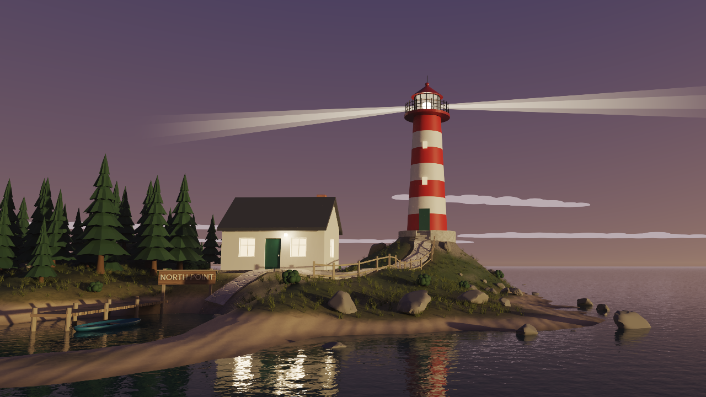
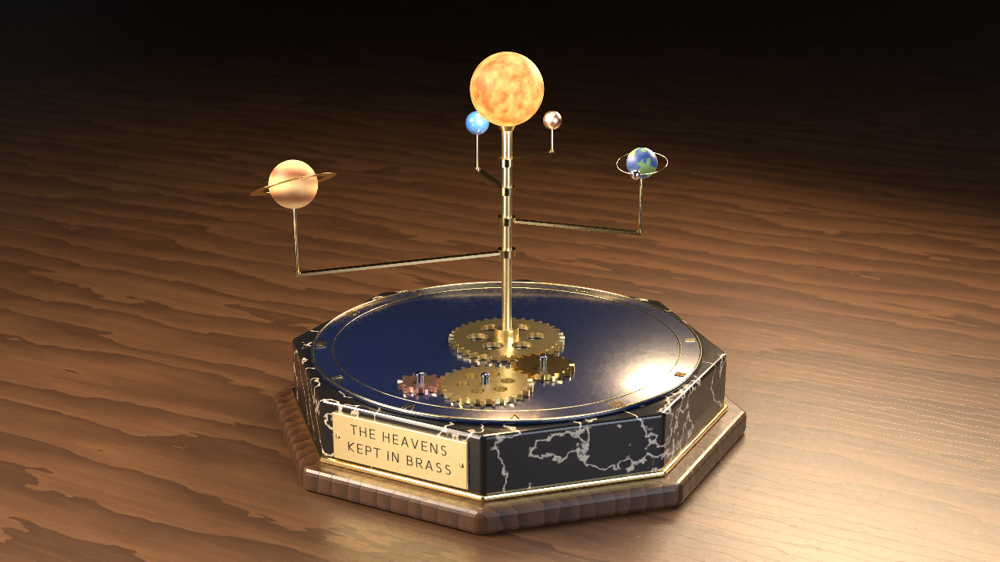
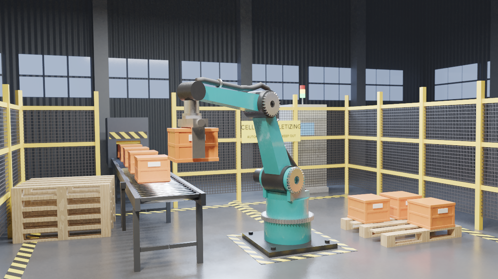
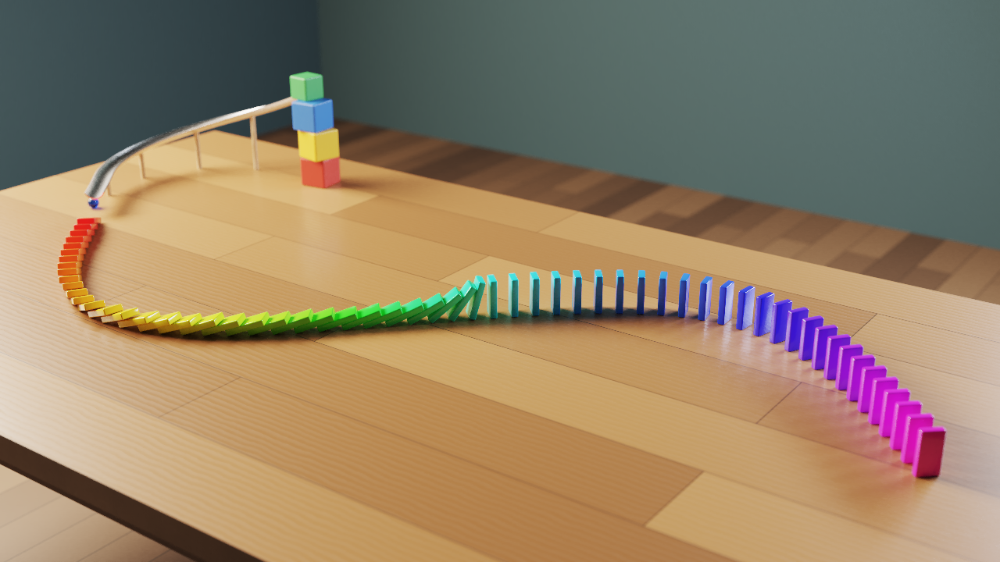

# Example projects

Five original scenes, each built from scratch by an AI agent that used **only the editor's MCP
server**: the same tools (`run_operator`, `batch`, `add_object`, `get_object`, `render_image`,
`export_scene` …) that any external agent gets. Nothing was modelled by hand or imported: every
object, material, light, animation and render comes from a tool call, and the scripts only
compute numbers and check what they read back. Each folder holds the agent's build script,
`build.mjs`, which deletes the project on the server, rebuilds it from nothing, checks the result
numerically and renders the outputs, so every project is reproducible on a fresh server.
Besides the tools listed per project below, every build uses `list_projects`, `delete_project` and
`create_project`.

Every folder contains:

- `build.mjs`: the reproducible build (all design numbers are constants in the file);
- `README.md`: how the scene is made, what the build checks, the timings of the final run and the
  known limitations;
- `render.png`: the final still, 1280 × 720, path traced and denoised;
- `contact_sheet.png` and `preview.gif`: the animation, path traced;
- `scene.glb`: the scene as glTF 2.0 binary with its animation, checked with the repository's glTF
  validator and with three.js;
- `editor.png`: the project open in the web editor.

## Lighthouse Cove

<a href="lighthouse-cove/"></a>

[Project folder](lighthouse-cove/) · [In the editor](lighthouse-cove/editor.png)

A small rocky island at dusk under a pink and violet sky. A red and white lighthouse sweeps two
opposite beams over the sea, the keeper's cottage has lit windows, and a flagstone path climbs from
a sandy cove past the cottage to the lighthouse door. A jetty, a rowing boat, a fence, a "NORTH
POINT" sign and 2,770 scattered pines, rocks, grass tufts and bushes complete it.

- **Editor features**: the terrain, building, fence, tree, rock, grass, bush and cloud generators;
  sculpting (GRAB, FLATTEN); per-vertex colours computed in the script and written in one call;
  scatter instancing with vertex-group density maps and a minimum distance (kept off the beach and
  the path); beams turned by drivers, with index-matched glass shafts standing in for volumetric
  light; a path dropped onto the ground with ray casts and banked with per-point tilt; Boolean
  steps; a Track To camera with lens shift; a sunset sky with mist.
- **MCP tools**: `set_scene_settings`, `run_operator`, `batch`, `add_object`, `transform_object`,
  `set_parent`, `set_material`, `add_modifier`, `edit_mesh`, `get_mesh_data`, `get_instances`,
  `get_object`, `get_scene`, `set_active_camera`, `render_image`, `render_animation`,
  `export_scene`.

## Clockwork Orrery

<a href="clockwork-orrery/"></a>

[Project folder](clockwork-orrery/) · [In the editor](clockwork-orrery/editor.png)

A brass orrery on a black marble plinth: four planets on arms around an emissive sun, a moon on
its own orbit, a four-wheel gear train on an enamelled dial and an engraved motto plate. One keyed
master channel drives the planets, the gears and the sun through 14 scripted drivers, the moon
follows its own path animation, and the 48-frame loop is seamless. The build verifies every driven
angle, the gear ratios, the moon's period and the clearance between all moving parts at every
frame.

- **Editor features**: the gear generator; scripted drivers on one master channel with CYCLIC
  extrapolation; a Follow Path constraint for the moon; text converted to a mesh and engraved with
  a live Boolean; Bevel; procedural marble, wood, noise and wave textures; area lights with shapes;
  depth of field; exact surface distances (`scene.measure`) at every frame and ray casts for the
  framing.
- **MCP tools**: `set_scene_settings`, `run_operator`, `batch`, `add_object`, `add_modifier`,
  `apply_modifier`, `duplicate_object`, `delete_objects`, `set_parent`, `set_active_camera`,
  `get_object` (evaluated values at a frame), `get_scene`, `render_image`, `render_animation`,
  `export_scene`.

## Robot Workcell

<a href="robot-workcell/"></a>

[Project folder](robot-workcell/) · [In the editor](robot-workcell/editor.png)

A four-axis palletizing robot lifts a crate off a roller conveyor, swings it through the cell and
sets it onto a pallet while the conveyor moves the queue forward. The cell has a welded-mesh safety
fence, hazard-striped floor markings, a light curtain, a controller cabinet with a blinking signal
tower and a dim factory hall around it.

- **Editor features**: an armature with a three-bone IK chain, per-bone IK locks and limits and a
  Damped Track wrist; bone-parented parts; a dress-pack hose skinned with automatic weights that
  the script corrects through vertex groups; a gripper shape key; a Child Of constraint with keyed
  influence for the carry; Array, Mirror and Bevel modifiers; procedural hazard stripes and an
  alpha-masked fence mesh; a driver that blinks a lamp; a camera that pans after the gripper with
  depth of field. `scene.glb` carries the skin and the morph target.
- **MCP tools**: `set_scene_settings`, `run_operator`, `batch`, `add_modifier`, `edit_mesh`,
  `duplicate_object`, `transform_object`, `insert_keyframe`, `set_active_camera`, `get_object`,
  `get_mesh_data`, `get_scene`, `render_image`, `render_animation`, `export_scene`.

## Domino Cascade

<a href="domino-cascade/"></a>

[Project folder](domino-cascade/) · [In the editor](domino-cascade/editor.png)

A blue glass marble rolls down a curved aluminium chute, shoots off the lip and knocks over the
first of 60 rainbow-coloured dominoes standing along an S-curve on an oak table. The build checks
the rigid-body simulation (every domino topples, in order; when and where the marble hits), keys a
focus target that follows the action, moves a showcase camera from the chute to the whole S and
bakes the simulation to keyframes.

- **Editor features**: rigid-body physics (active and passive bodies with box, sphere, mesh,
  convex hull and cylinder shapes; world settings; describing and baking the simulation); a chute
  swept from a profile curve as a bevel object and converted to a mesh; the table generator;
  linked duplicates placed along a curve; Bevel; procedural boards and grain; a Track To camera;
  RASTER inspection contact sheets; depth of field in the path tracer.
- **MCP tools**: `run_operator`, `batch`, `add_modifier`, `apply_modifier`, `set_material`,
  `delete_objects`, `set_scene_settings`, `get_object`, `get_scene`, `set_active_camera`,
  `render_image`, `render_animation`, `export_scene`.

## Product Shot

<a href="product-shot/"></a>

[Project folder](product-shot/) · [In the editor](product-shot/editor.png)

An invented perfume, "Vellune": a faceted glass flacon with amber perfume, a gold cap and a front
label with a crescent emblem, on a marble plinth in a wine-red studio sweep, lit like a product
photograph. The camera orbits the bottle in a seamless 36-frame turntable.

- **Editor features**: profile curves revolved by the Screw modifier (lathe) with Smooth by Angle;
  glass and liquid with transmission and IOR; filled and extruded 2D curves and text for the label;
  material presets with clear coat and sheen and a procedural marble; area lights with shapes and
  a spot; depth of field with a focus object; `anim.turntable`; the Khronos PBR Neutral view
  transform.
- **MCP tools**: `set_scene_settings`, `add_object`, `add_modifier`, `set_material`,
  `set_active_camera`, `run_operator`, `batch`, `get_scene`, `get_object`, `render_image`,
  `render_animation`, `export_scene`.

## Rebuild a project

From a clone of the repository, install, build and start the editor server (it listens on port
8080), then run a project's build script against its MCP endpoint from the repository root:

```bash
npm ci && npm run build && npm start
MCP_URL=http://127.0.0.1:8080/mcp node examples/<slug>/build.mjs
```

`<slug>` is the folder name: `lighthouse-cove`, `clockwork-orrery`, `robot-workcell`,
`domino-cascade` or `product-shot`. The default mode rebuilds the project and renders
`render.png`, `contact_sheet.png` and `preview.gif` into its folder, replacing the committed
files; the final runs took 9 to 14 minutes per project on a busy 4-core machine with 3 render
threads (`RENDER_WORKERS=3`). The quicker modes rebuild and check the scene without path tracing:

| Project | Scene and checks only | Scene, checks and `scene.glb` |
| --- | --- | --- |
| `lighthouse-cove` | `--build-only` | `--export-only` |
| `clockwork-orrery` | `--build-only` | `--export-only` |
| `robot-workcell` | `--no-render` | `--export-only` |
| `domino-cascade` | `--build-only` (also writes RASTER inspection sheets to `$WORK_DIR`) | `--export-only` |
| `product-shot` | `--build-only` | `--export-only` |

`--export-only` writes `scene.glb` into the project folder, replacing the committed file. Each
script also has a preview mode that writes small RASTER and path-traced images outside the project
folder, and options to send the outputs elsewhere; the header of each `build.mjs` and its
`README.md` list them. Any tool error or failed check stops a build with a non-zero exit code.
