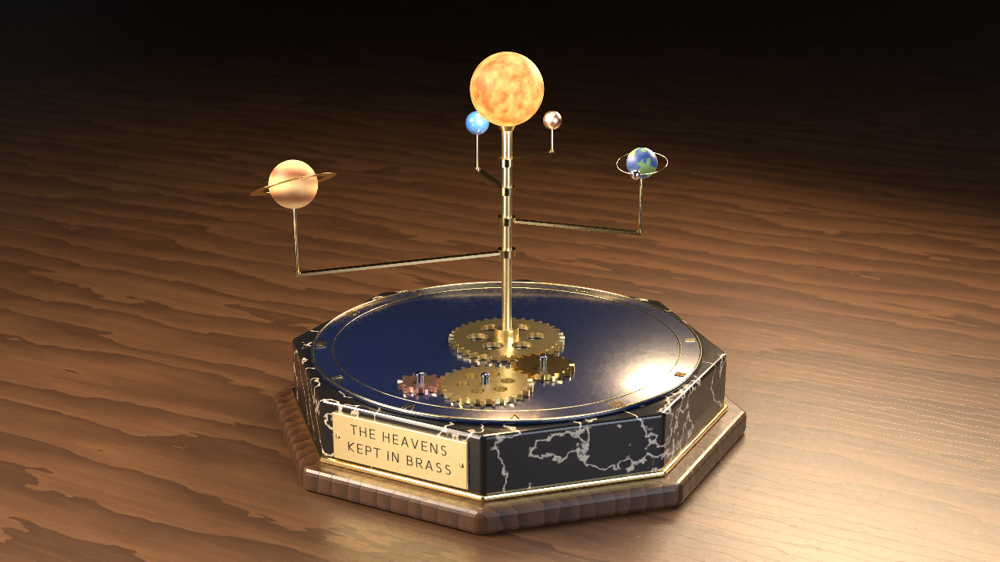
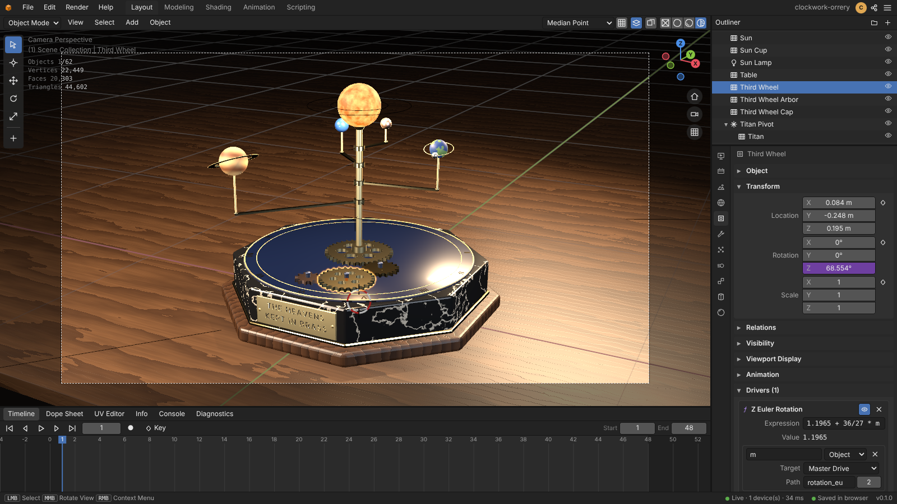

# Clockwork Orrery

An original brass clockwork orrery on a dark marble plinth, built entirely through the editor's MCP
server by [`build.mjs`](build.mjs), with the same tools an external AI agent uses. Every step
(modelling, materials, the driven mechanism, lights, camera, renders, the glTF export) is a tool
call. The script rebuilds the project from scratch, checks the result numerically and renders the
outputs.



| Contact sheet (every 4th frame of the 48-frame loop) | Animated preview (48 frames, loops seamlessly) |
| --- | --- |
|  |  |

Files in this folder:

| File | What it is | Made by |
| --- | --- | --- |
| [`build.mjs`](build.mjs) | the build script | |
| `render.png` | path-traced still, 1280×720 | `build.mjs` (default mode) |
| `contact_sheet.png` | 12 path-traced frames of the loop | `build.mjs` (default mode) |
| `preview.gif` | the whole 48-frame loop, path traced | `build.mjs` (default mode) |
| [`scene.glb`](scene.glb) | the animated scene as binary glTF 2.0 ([below](#sceneglb)) | `build.mjs --export-only` |
| `editor.png` | the project open in the web editor ([below](#in-the-editor)) | Playwright screenshot |

## The scene

* **Plinth**: an octagonal block of black marble with thin warm-white veins (procedural `MARBLE`)
  on a dark walnut foot, with a gilt moulding between them. On top sits an enamelled midnight-blue
  deck with two gilt chapter rings and twelve radial Roman numerals (text objects), like a clock
  dial. The plinth stands on an oiled wooden table (procedural `WOOD` rings and grain).
* **Motto plate**: a brass plate on the front face with the original motto
  **THE HEAVENS / KEPT IN BRASS**. The text is converted to a mesh, engraved 2 mm deep with a live
  `BOOLEAN` difference and filled with black wax. Two domed gilt screws hold the plate.
* **Gear train**: four wheels from `object.generate_gear` with different tooth counts: a 36-tooth
  great wheel on the central spindle, an 18-tooth gilt idler, a 27-tooth third wheel and a 12-tooth
  copper pinion. They share one module (6.6 mm) and sit at the sum of their pitch radii (+0.8 mm
  backlash). Each wheel is phased so that a tooth of the driving wheel sits in a gap of the next.
  The two large wheels have six lightening windows (cylinders joined, cut with `BOOLEAN`, applied).
  The idler, the third wheel and the pinion run on blued-steel arbors with domed caps; the great
  wheel sits on the spindle under a brass hub.
* **Sun**: an emissive sphere with a granulated procedural emission (`NOISE`) on a near-black base,
  so the studio lights do not wash it out. It sits in a gilt cup on the brass spindle. A warm `POINT`
  lamp inside it (radius just larger than the sphere) lights the sun-facing sides of the planets,
  like the lamp of a real orrery.
* **Planets** on polished-brass arms (collar, bar, post and cup joined into one mesh). Each planet
  has its own size, material and period:

  | Planet | Material | Orbit radius | Planet radius | Arm height | Period | Swept annulus |
  | --- | --- | --- | --- | --- | --- | --- |
  | Ember | `copper` preset | 0.125 m | 20 mm | 0.585 m | 12 frames | r 0.1050–0.1450 m |
  | Azure | `ceramic` preset, blue glaze | 0.185 m | 26 mm | 0.525 m | 16 frames | r 0.1590–0.2110 m |
  | Verdant | procedural land and sea (`NOISE`) | 0.285 m | 31 mm | 0.460 m | 24 frames | r 0.2245–0.3455 m (with the moon) |
  | Titan | banded giant (`WAVE`) with a gilt ring | 0.445 m | 48 mm | 0.390 m | 48 frames | r 0.3581–0.5319 m (with the ring) |

* **Moon**: a silver moon on a thin brass Bezier circle (radius 50 mm, tilted 14°) around Verdant.
  It is driven by a `FOLLOW_PATH` constraint timed with `constraint.followpath_path_animate`, one
  orbit every 12 frames. The circle rides on Verdant's arm, so the moon follows the planet around
  the sun.
* **Materials**: presets `brass`, `gold`, `copper`, `marble`, `wood`, `silver` and `ceramic`
  (`material.preset_apply`), tuned with `material.update` and procedural textures
  (`material.procedural_set`: `MARBLE`, `WOOD`, `NOISE`, `WAVE`).
* **Light**: a warm studio of `AREA` lights, each created with its shape and size by
  `object.light_add` and aimed with `object.track_set`:
  * a rectangular key soft box (1.1 × 0.7 m);
  * a cool disk fill;
  * a narrow rectangular rim strip behind (1.5 × 0.32 m) that draws edge highlights on the brass;
  * a disk top light;
  * a small rectangular kicker that grazes the motto plate.

  A dim `STUDIO` environment adds reflections, and the backdrop is very dark and warm.
* **Camera**: 50 mm lens with depth of field at f/4, focused on the `Focus` empty in the middle of
  the planet ring (`object.camera_add {dof_use, dof_focus_object, dof_aperture_fstop}`). The orrery
  is sharp and the table falls into soft blur. The table (24 × 16 m) is larger than the view, so
  none of its edges shows: the wood simply fades into the dark.

Scale: metres, Z up. The plinth is 1.04 m across, and the top of the sun is 0.81 m above the table.

## The mechanism: one master channel, everything else driven

The empty **Master Drive** carries the only keyframes of the mechanism. Its rotation Z goes linearly
from 0 to 2π between frames 1 and 49 (`anim.keyframes_insert_many`, `LINEAR`) and repeats forever
(`anim.extrapolation_set {type: CYCLIC}`). All 14 rotating parts have a scripted driver
(`anim.driver_add`) that reads it as `m`:

| Part | Driver expression | Turns per 48-frame loop |
| --- | --- | --- |
| Ember arm / spin | `1.1868 + 4 * m` / `8 * m` | 4 orbits / 8 spins |
| Azure arm / spin | `2.4086 + 3 * m` / `6 * m` | 3 / 6 |
| Verdant arm / spin | `0.1396 + 2 * m` / `4 * m` | 2 / 4 |
| Titan arm / spin | `3.9794 + m` / `3 * m` | 1 / 3 |
| Great Wheel (36 T) | `m` | +1 |
| Idler Wheel (18 T) | `2.3736 - 36/18 * m` | −2 |
| Third Wheel (27 T) | `1.1965 + 36/27 * m` | +4/3 |
| Pinion (12 T) | `0.3047 - 36/12 * m` | −3 |
| Hub / Sun | `m` / `-m` | +1 / −1 |

In a simple gear train each wheel turns `T_great / T` times as fast as the great wheel, and the
direction alternates. So every meshing pair A → B turns in opposite directions at the ratio
`T_A / T_B`. The constant terms are start angles: the starting positions of the planets, and for
the gears the phase that puts a tooth of the driving wheel into a gap of the driven one, on the line
between their centres.

The moon is the one part with its own timing. `constraint.followpath_path_animate` keys the
`Moon Orbit` curve's `eval_time` from 0 to 100 over frames 1–13, with `LINEAR` extrapolation, so
the moon makes one orbit every 12 frames, four per master turn.

The loop is seamless. Every planet makes whole orbits and spins in 48 frames, the moon makes four
orbits, and every gear turns by a multiple of its rotational symmetry. For example, the 27-tooth
wheel turns 4/3 of a turn per loop, so it has six windows: gcd(27, 6) = 3, and 4/3 is a multiple
of 1/3.

### Layout: the arms cannot collide

Each arm carries a "head": the planet plus Titan's ring or Verdant's moon on its orbit. As the arm
turns, the head sweeps an annulus around the spindle (the last column of the planet table).
`layoutPlanets()` checks before any editor call that neighbouring annuli are at least 10 mm apart.
The actual gaps are 14, 13.5 and 12.6 mm. Inner arms also ride higher than outer arms, so every
outer bar passes under the inner assemblies. Two assemblies therefore cannot touch at any angle,
whatever the phase between them. Around frames 29–33 Titan, Verdant (with its moon) and Azure line
up behind the sun as seen from the camera. They overlap in the picture there, but pass behind one
another: at every frame they stay at least 26 mm apart.

## Verification

The build fails (exit code 1) unless all of these checks pass on the built scene:

* **`verifyScene()`**: `get_scene` reports no evaluation `problems`.
* **`verifyMotion()`**: reads the **evaluated** transforms back with `get_object {frame}`.
  * Every driven angle at frames 1, 4, 7, 13, 25, 37 and 49 matches its design formula, and
    `get_object` lists the overridden document value as `stored`.
  * Every meshing pair turns in opposite directions at the ratio of its tooth counts.
  * Every planet stays at its orbit radius.
  * The moon stays 50 mm from Verdant and in its orbit plane. Its angle along the orbit, measured
    in the arm's frame (relative to Verdant, turned back by the arm's angle), advances by a quarter
    orbit every 3 frames: one orbit every 12 frames.
  * Frame 49 looks exactly like frame 1: every part turns by a whole multiple of its rotational
    symmetry per loop.
* **`verifyClearance()`**: runs `scene.measure {surface_distance: true, frame}` at all 48 frames on
  groups of at most 8 objects. Together the groups cover every pair of separately moving parts:
  the planet assemblies, the moon and its orbit, the sun and the four wheels. Contacts within one
  assembly (a planet in its cup, the moon threaded on its wire) are by design and skipped. Planet
  parts must stay at least 5 mm apart, and gear teeth at least 0.2 mm (they keep 0.8 mm).
* **`verifyFraming()`**: casts rays (`scene.raycast`) from the camera through the four image corners.
  All four must hit the top face of the table, so no table edge can enter the picture.
* **Renders** (default mode): a dropped animation frame (`truncated`) fails the build; frames that
  stopped sampling early (`undersampled_frames`) and render warnings are listed at the end.
* **`exportGlb()`** (`--export-only`): every channel of the file's animation must have at least 49
  keys over frames 1–49 (one per frame, more where a path curves between frames), and the animation
  must move all 14 driven parts and the moon.

Excerpt from the final production run:

```
Great Wheel 36T → Idler Wheel 18T: Δθ 1.571 → -3.142 rad (ratio -2.0000 = −36/18)
Idler Wheel 18T → Third Wheel 27T: Δθ -3.142 → 2.094 rad (ratio -0.6667 = −18/27)
Third Wheel 27T → Pinion 12T: Δθ 2.094 → -4.712 rad (ratio -2.2500 = −27/12)
moon 0.05 m from Verdant; angle along its orbit (arm frame) since frame 1: f4 89.9°, f7 179.9°, f10 269.9°, f13 -0.0° (1 orbit), f25 -0.0° (2 orbits), f49 -0.0° (4 orbits) → one orbit every 12 frames
✓ motion verified: 14 driven parts × 7 frames, 3 meshing pairs, moon period, seamless 48-frame loop
closest: Great Wheel / Idler Wheel    0.8 mm at frame 4
closest: Idler Wheel / Third Wheel    0.8 mm at frame 3
closest: Pinion / Third Wheel         0.8 mm at frame 4
closest: Azure / Ember                19.4 mm at frame 10
closest: Azure / Moon                 26.6 mm at frame 33
closest: Azure / Ember Arm            26.6 mm at frame 10
closest: Moon Orbit / Titan Ring      28.5 mm at frame 31
closest: Azure / Moon Orbit           28.8 mm at frame 32
✓ clearance verified: 61 pairs of moving parts × 48 frames in 53.7 s (planets ≥ 5 mm, gear teeth never cross)
✓ framing: all four image corners see the table top: top left (-7.00, 5.11, 0.00); top right (-0.36, 8.64, 0.00); bottom left (-0.51, -0.96, 0.00); bottom right (1.06, -0.12, 0.00)
```

The contact sheet and the GIF are the visual check of the same motion.

## In the editor



The built project open in the web editor (the `editor:` URL that the script prints), in the camera
view with **Rendered** viewport shading. The Third Wheel is selected in the outliner. The
Properties editor shows its Z rotation in purple, because a driver sets it (68.554° at frame 1),
and the Drivers panel with the expression `1.1965 + 36/27 * m`, whose variable `m` reads the
Master Drive's Z rotation (`rotation_euler[2]`). The viewport is the editor's real-time WebGL
preview (its area lights cast no shadows, and there is no depth of field and no global
illumination), so it looks brighter and flatter than the path-traced still. The screenshot was
taken with Playwright Chromium at 1600×900 (software WebGL) after the scene had loaded; the browser
console stayed free of errors and warnings.

## scene.glb

[`scene.glb`](scene.glb) (4.66 MB, binary glTF 2.0) is written by `--export-only` with
`export_scene`. The exporter samples the evaluated scene once per frame, so the live drivers and the
moon's Follow Path constraint need no baking; where a path curves between two frames, as the moon's
fast orbit does, it also samples between the frames. For the export the scene's frame range is set
to 1–49 (frame 49 looks exactly like frame 1), so the clip ends where it starts and loops
seamlessly; the script then sets it back to 1–48. The file contains:

* 61 nodes: 48 meshes with their modifiers applied (bevels, the engraved plate; 44,602 triangles),
  the 50 mm camera, 6 lights (`KHR_lights_punctual`) and the 6 empties. The planet assemblies are
  children of their pivot empties, as in the editor.
* 16 PBR materials (`KHR_materials_clearcoat` on the enamel deck and Azure's glaze,
  `KHR_materials_emissive_strength` on the sun). The 6 procedural textures are baked into 8 PNG
  images: base colours, the sun's emission and normal maps for the two woods. The exporter sizes
  each bake by the surface it covers: 2048 × 2048 pixels for the 24 × 16 m table (its colour and
  normal map), 512 × 512 for the rest.
* One animation, `Scene`: 2.0 s at 24 fps, 17 channels on 16 nodes. The rotations of the 14 driven
  parts (pivots, planets, wheels, hub, sun) and of the Master Drive have 49 linear keys, one per
  frame. The moon's translation and rotation have 161 keys: 2 or 4 per frame (4 in 32 of the 48
  frame intervals), so its path stays round between the frames.
* No skins and no morph targets: the scene has no armature and no shape keys.

Export warnings (all five expected; glTF has no area lights):

```
Area light 'Fill Light' exported as a point light
Area light 'Key Light' exported as a point light
Area light 'Plate Kicker' exported as a point light
Area light 'Rim Light' exported as a point light
Area light 'Top Light' exported as a point light
```

Checks of the committed file:

* Structure: the repository's glTF test validator (`parseGltf` / `gltfProblems` in
  `packages/core/test/fixes-export-gltf-check.ts`) finds no problems: buffer views, accessor bounds,
  node hierarchy and animation samplers are valid. Sampled with the validator's evaluator
  (`gltfPose`), every planet stays on its orbit radius and the moon 50 mm from Verdant at frames 1,
  7, 13, 25 and 49.
  The last key equals the first, except the Third Wheel, which ends turned by 120°: a symmetry of
  its 27 teeth and 6 windows, so the loop has no visible seam.
* three.js r187: `GLTFLoader` in headless Chromium loads the file (1 clip of 2 s with 17 tracks,
  48 meshes, 6 lights, 1 camera, no console errors). Played with an `AnimationMixer` and sampled at
  240 Hz over two loops, the four planets stay on their orbit radii (within 0.0001 mm), the moon
  stays 49.4–50.0 mm from Verdant, and the mixer repeats the clip: Ember is at the same place at
  t = 0.25 s, 2.25 s and 4.25 s.

## Editor features shown

* **MCP tools**: `list_projects`, `delete_project`, `create_project`, `set_scene_settings`,
  `run_operator`, `batch` (with per-operation `reports`), `add_object`, `add_modifier`,
  `apply_modifier`, `duplicate_object`, `delete_objects`, `set_parent`, `set_active_camera`,
  `get_object` (evaluated values at a frame, `stored` values, `world_location`, `world_transform`),
  `get_scene` (`counts`, `problems`), `render_image`, `render_animation` (`CONTACT_SHEET`, `GIF`,
  `samples_reached`), `export_scene` (glTF with the drivers and the constraint sampled per frame).
* **Operators**:
  * modelling: `object.generate_gear`; `mesh.primitive_cube_add / cylinder_add / cone_add /
    uv_sphere_add / torus_add`; `curve.primitive_bezier_circle_add` (with `bevel_depth`),
    `curve.switch_direction`; `object.text_add`, `font.text_set`, `object.convert {target: MESH}`;
    `object.join`, `object.transform_apply`, `object.shade_smooth`, `object.shade_auto_smooth`;
  * materials: `object.material_assign`, `material.new`, `material.preset_apply`,
    `material.update`, `material.procedural_set`;
  * animation: `object.constraint_add {FOLLOW_PATH}`, `constraint.followpath_path_animate`;
    `anim.keyframes_insert_many`, `anim.extrapolation_set {CYCLIC}`, `anim.driver_add` (scripted
    expressions with an object variable);
  * lights and camera: `object.light_add` (AREA shapes `RECTANGLE` / `DISK` with sizes, `POINT`
    radius), `object.camera_add` (depth of field with a focus object), `object.track_set`;
  * measuring: `scene.measure` (exact surface distances at a given frame), `scene.raycast`
    (against chosen objects at a given frame);
  * `data.set_property` (world settings, object visibility).
* **Modifiers**: `BEVEL` (angle limited) on the plinth parts and the plate; `BOOLEAN` difference for
  the engraving (live) and for the gear windows (applied).
* **Rendering**: the CPU path tracer with denoising, depth of field, area-light shapes, procedural
  textures, an emissive mesh plus a point light, and the `STANDARD` view transform with exposure.
  The denoiser also cleans the few-sample animation frames.
* **Web editor**: camera view, Rendered shading, outliner, the Object tab's driven fields and
  Drivers panel ([`editor.png`](editor.png)).

## Rebuild

From a clone of the repository: install, build and start the editor server (it listens on port
8080; `PORT`, `DATA_DIR` and `RENDER_WORKERS` are optional), then run the script in a second
terminal with `MCP_URL` pointing at the server's `/mcp` endpoint:

```bash
npm ci && npm run build && npm start
MCP_URL=http://127.0.0.1:8080/mcp node examples/clockwork-orrery/build.mjs                 # = --final
MCP_URL=http://127.0.0.1:8080/mcp node examples/clockwork-orrery/build.mjs --build-only    # scene + checks only
MCP_URL=http://127.0.0.1:8080/mcp node examples/clockwork-orrery/build.mjs --export-only   # + scene.glb
```

The script always deletes and recreates the project `clockwork-orrery` (open it in the editor at
the printed `editor:` URL), runs every check above, and then does what the mode asks for:

| Mode | What it does | Time |
| --- | --- | --- |
| `--final` (default) | build + checks, `render.png`, `contact_sheet.png`, `preview.gif` | 13 min with 3 render processes on a busy 4-core machine (see below) |
| `--build-only` | build + checks, no renders | 41 s (38 s of it the clearance sweep) |
| `--preview` | build + checks + 960×540 RASTER still, 640×360 path-traced still (16 spp) and RASTER contact sheet in `$PREVIEW_DIR` (default `$TMPDIR/clockwork-orrery-previews`); nothing is written next to the script | 111 s with 1 render process on a busy machine |
| `--export-only` | build + checks + `scene.glb` (no renders) | 71 s (the export itself 15 s, 2 render processes) |
| `--stages build,still,…` | any combination of `build`, `preview`, `still`, `anim`, `export` | |

The times of the last three modes were measured on the same busy machine with one render process
(`--export-only` with two, on the final code).
`--out-dir DIR` writes `render.png`, `contact_sheet.png`, `preview.gif` and `scene.glb` to another
folder. The command line is strict: an unknown argument (e.g. `build-only` without the dashes), an
unknown stage name, two modes at once or a flag without its value stops the script with exit
code 2, before it connects to the server. Any tool error, failed batch operation, scene problem,
motion mismatch, collision, framing failure, dropped animation frame or wrong glTF animation stops
it with exit code 1.

`scene.glb` is not part of the default mode; `--export-only` makes it (see [scene.glb](#sceneglb)).

## Final production run

`render.png`, `contact_sheet.png` and `preview.gif` come from one run of the default mode on a
fresh editor server with an empty data directory and three render processes, so the run also proves
that the project rebuilds from scratch. The server was this repository's production build
(`npm run build` at commit `999b4dc`), started like `npm start`:

```bash
PORT=4562 DATA_DIR=$(mktemp -d) RENDER_WORKERS=3 npm start &
MCP_URL=http://127.0.0.1:4562/mcp node examples/clockwork-orrery/build.mjs --final
```

Measured on 2026-11-06 on a 4-core machine that was busy with other work at the same time (load
average 11–16 while the still rendered, 6–9 during the animation):

| Stage | Settings | Wall time | Result |
| --- | --- | --- | --- |
| build + checks | 62 objects (36 meshes, 12 texts, 1 curve, 6 lights, 6 empties, 1 camera), 16 materials, 14 drivers; 44,602 rendered triangles | 58.4 s (53.7 s of it the clearance sweep) | every check passed, no scene problems |
| `render.png` | 1280×720, path tracer, 160 spp requested, `time_limit` 470 s, 6 bounces, denoised, f/4 depth of field | 474.0 s | the time limit stopped sampling at 71 spp; the denoised image shows no noise at full size; 0.97 MB |
| `contact_sheet.png` | 12 frames (1, 5 … 45), 320×180 each, 12 spp, 4 bounces, denoised | 37.3 s | every frame at 12 spp; 0.75 MB |
| `preview.gif` | 48 frames, 480×270, 8 spp, 4 bounces, denoised, 16 fps, Bayer dither, `time_limit` 600 s | 207.3 s | every frame at 8 spp (`samples_reached` min = max = 8); 0.91 MB |
| **total** | | **777.0 s (13.0 min)** | exit code 0; 3 warnings, all the plate's degenerate triangles (see below) |

`get_scene` counts the 44,602 triangles that render as `evaluated`, and the 3,044 of the hidden
text mesh that cuts the engraving under `not_rendered`.

Every GIF frame reached the same sample count, and the path tracer uses the same noise seed for
every frame, so the parts of the picture that do not move are nearly identical from frame to frame.
On a patch of the table (x 380–480, y 150–230) the mean difference between consecutive frames is
0.11–0.25 grey levels out of 255 for every pair, including the loop seam 48 → 1 (0.19). The
high-pass noise of the same patch (standard deviation of the patch minus its 3 × 3 box blur) is
3.63–3.68 grey levels in all 48 frames, so the table does not shimmer.

`editor.png` was made with a second server running the same build (one render process): the
screenshot shows the project of an `--export-only` run open in the editor. `scene.glb` comes from
an `--export-only` run on the final code (2026-11-07, after the last fixes to the exporter and the
triangulation; 71 s, the export itself 15 s; a second run wrote a byte-identical file). A preview
path-traced on that code (640×360, 24 spp) matches `render.png` and no longer warns about
degenerate triangles, so the renders were kept.

## Known limitations

* The renders of the final production run warned `4 degenerate triangle(s) skipped (…): 'Motto
  Plate' 4`. The boolean engraving leaves large n-gons (up to 477 corners) with collinear vertices
  along the letters, and their triangulation had four zero-area triangles, which cover no pixels.
  The editor's triangulation now removes such triangles, so renders of the current build no longer
  warn.
* RASTER previews (`--preview`; the server's software rasterizer renders them when no editor is
  open in a browser) have no shadows and no depth of field, and they reflect a single reflection
  probe placed where the image centre looks (at the spindle). The far part of the glossy table
  therefore shows a bright sheen that the path tracer does not have. Use them for layout and
  motion, not for judging the light.
* On a busy machine the still's 470 s budget is not enough for 160 spp at 1280×720 with three
  render processes: the final run stopped at 71 spp under a load average of 11–16. The denoiser
  cleans the result, but a quieter machine gives a more converged image.
* Most of the build time is the clearance sweep: 192 `scene.measure` calls (48 frames × 4 groups),
  because a call measures one frame and the script measures groups of at most 8 objects (the limit
  of exact surface distances when it was written; `scene.measure` now takes up to 25). The motion
  check's 125 `get_object` calls take only a few seconds.
* The clearance sweep samples whole frames only. Between frames the planets are kept apart by the
  disjoint annuli (the design guarantees it); the gear teeth were measured at the 48 frames only.
* `scene.glb` is an approximation of the scene: the five area lights become point lights (glTF has
  no area lights), the procedural textures are baked into images (2048 pixels across the 24 m
  table, 512 for the smaller parts, so fine detail such as the marble's thin veins is softened), and
  glTF players interpolate the keys linearly. Rotations stay exact, and the extra keys on the moon's
  curved path keep it within 0.6 mm of its 50 mm orbit around Verdant in three.js (with one key per
  frame it cut chords up to 6 mm deep).
* The near numerals of the dial (V, VI, VII) read upside down from the camera, as on a real dial
  with radial numerals.
