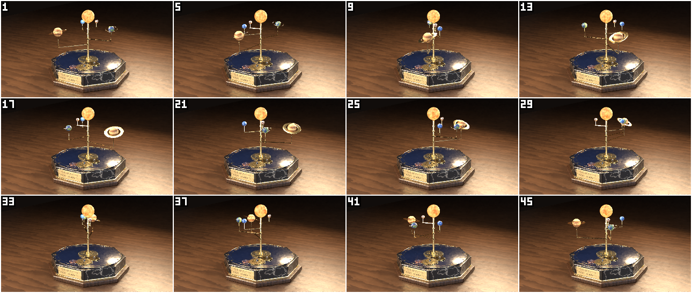
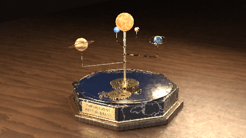

# Clockwork Orrery

An original brass clockwork orrery on a dark marble plinth, built entirely through the editor's MCP
server by [`build.mjs`](build.mjs) — the same tools an external AI agent uses. Every step (modelling,
materials, the driven mechanism, lights, camera, renders) is a tool call; the script rebuilds the
project from scratch, checks the result numerically and renders the outputs.


| Contact sheet (every 4th frame of the 48-frame loop) | Animated preview (48 frames, loops seamlessly) |
| --- | --- |
|  |  |

## The scene

* **Plinth** — an octagonal block of black marble with thin warm-white veins (procedural `MARBLE`)
  on a dark walnut foot, a gilt moulding between them, and an enamelled midnight-blue deck with two
  gilt chapter rings and twelve radial Roman numerals (text objects), like a clock dial.
* **Motto plate** — a brass plate on the front face with the original motto
  **THE HEAVENS / KEPT IN BRASS**: the text is converted to a mesh, engraved 2 mm deep with a `BOOLEAN`
  difference and filled with black wax; two domed gilt screws.
* **Gear train** — four wheels from `object.generate_gear` with different tooth counts — a 36-tooth
  great wheel on the central spindle, an 18-tooth gilt idler, a 27-tooth third wheel and a 12-tooth
  copper pinion. They share one module (6.6 mm), sit at the sum of their pitch radii (+0.8 mm
  backlash) and are phased so a tooth of one wheel sits in a gap of the next. The two large wheels have
  six lightening windows (cylinders joined, cut with `BOOLEAN`, applied); the small ones run on
  blued-steel arbors with domed caps.
* **Sun** — an emissive sphere with a granulated procedural emission (`NOISE`) on a near-black base, so
  the studio lights do not wash it out, held in a gilt cup on the brass spindle. A warm `POINT` lamp
  inside it (radius just larger than the sphere) lights the sun-facing sides of the planets, like the
  lamp of a real orrery.
* **Planets** on polished-brass arms (collar, bar, post, cup joined into one mesh), each with its own
  size, material and period: *Ember* (copper preset, 12 frames per orbit), *Azure* (ceramic glaze,
  16), *Verdant* (procedural land and sea, 24) and *Titan* (banded `WAVE` giant with a gilt ring, 48).
* **Moon** — a silver moon on a thin brass Bezier circle around Verdant: `FOLLOW_PATH` constraint timed
  with `constraint.followpath_path_animate` (one orbit every 12 frames); the circle rides on Verdant's
  arm, so the moon follows the planet around the sun.
* **Materials** — presets `brass`, `gold`, `copper`, `marble`, `wood`, `silver` and `ceramic`
  (`material.preset_apply`), tuned with `material.update` and procedural textures
  (`material.procedural_set`: `MARBLE`, `WOOD`, `NOISE`, `WAVE`).
* **Light** — a warm studio: a rectangular key soft box (1.1 × 0.7 m), a cool disk fill, a narrow
  rectangular rim strip behind (1.5 × 0.32 m) that draws edge highlights on the brass, a disk top light
  and a small rectangular kicker that grazes the motto plate — all `AREA` lights created with their
  shape and size by `object.light_add` and aimed with `object.track_set`; a dim `STUDIO` environment
  for reflections and a very dark warm backdrop.
* **Camera** — 50 mm, depth of field at f/4 focused on the `Focus` empty in the middle of the planet
  ring (`object.camera_add {dof_use, dof_focus_object, dof_aperture_fstop}`), so the orrery is sharp
  and the oiled wooden table melts into the dark.

Scale: metres, Z up. The plinth is 1.04 m across, the sun's top is 0.81 m above the table.

## The mechanism: one master channel, everything else driven

The empty **Master Drive** carries the only keyframes of the scene: rotation Z goes linearly from 0 to
2π between frames 1 and 49 (`anim.keyframes_insert_many`, `LINEAR`), repeated forever by
`anim.extrapolation_set {type: CYCLIC}`. Every moving part has a scripted driver (`anim.driver_add`)
that reads it as `m`:

| Part | Driver expression | Turns per 48-frame loop |
| --- | --- | --- |
| Ember arm / spin | `1.1868 + 4 * m` / `8 * m` | 4 orbits / 8 spins |
| Azure arm / spin | `2.4086 + 3 * m` / `6 * m` | 3 / 6 |
| Verdant arm / spin | `0.1396 + 2 * m` / `4 * m` | 2 / 4 |
| Titan arm / spin | `3.9794 + m` / `3 * m` | 1 / 3 |
| Great Wheel (36 T) | `m` | +1 |
| Idler Wheel (18 T) | `2.3736 - 36/18 * m` | −2 |
| Third Wheel (27 T) | `1.1965 + 36/27 * m` | +4/3 |
| Pinion (12 T) | `0.3047 - 36/12 * m` | −3 |
| Hub / Sun | `m` / `-m` | +1 / −1 |

In a simple gear train each wheel turns `T_great / T` times as fast as the great wheel and the sense
alternates, so every meshing pair A → B turns in opposite directions at the ratio `T_A / T_B`. The
constant terms are the start angles: the planets' starting positions, and for the gears the phase that
puts a tooth of the driving wheel into a gap of the driven one on the line between their centres.

The loop is seamless: every planet makes whole orbits and spins in 48 frames, and every gear turns by a
multiple of its rotational symmetry (the 27-tooth wheel turns 4/3 of a turn, so it has six windows:
gcd(27, 6) = 3, and 4/3 is a multiple of 1/3).

### Verification

`verifyMotion()` reads the **evaluated** transforms back with `get_object {frame}` and fails the build
if anything is off. It checks every driven angle at frames 1, 4, 7, 13, 25, 37 and 49 against the
design formula (and that `get_object` lists the overridden document value as `stored`), the ratio
and opposite sense of every meshing pair, the orbit radius of every planet, the moon's distance from
Verdant (0.068 m) and its 12-frame period, and that frame 49 is identical to frame 1. From the final
production run:

```
Great Wheel 36T → Idler Wheel 18T: Δθ 1.571 → -3.142 rad (ratio -2.0000 = −36/18)
Idler Wheel 18T → Third Wheel 27T: Δθ -3.142 → 2.094 rad (ratio -0.6667 = −18/27)
Third Wheel 27T → Pinion 12T: Δθ 2.094 → -4.712 rad (ratio -2.2500 = −27/12)
moon 0.068 m from Verdant at frames 1,4,7,13,25,49; back at its start every 12 frames
✓ motion verified: 14 driven parts × 7 frames, 3 meshing pairs, moon path, seamless 48-frame loop
```

`get_scene` must also report no evaluation `problems`. The contact sheet and the GIF are the visual
check of the same motion.

## Editor features shown

* **MCP tools**: `list_projects`, `delete_project`, `create_project`, `set_scene_settings`,
  `run_operator`, `batch` (with per-operation `reports`), `add_object`, `add_modifier`,
  `apply_modifier`, `duplicate_object`, `delete_objects`, `set_parent`, `set_active_camera`,
  `get_object` (evaluated values at a frame, `stored` values, `world_location`), `get_scene`
  (`counts`, `problems`), `render_image`, `render_animation` (`CONTACT_SHEET`, `GIF`), `export_scene`,
  `undo`.
* **Operators**: `object.generate_gear`; `mesh.primitive_cube_add / cylinder_add / cone_add /
  uv_sphere_add / torus_add`; `curve.primitive_bezier_circle_add` (with `bevel_depth`),
  `curve.switch_direction`; `object.text_add`, `font.text_set`, `object.convert {target: MESH}`;
  `object.join`, `object.transform_apply`, `object.shade_smooth`, `object.shade_auto_smooth`;
  `object.material_assign`, `material.new`, `material.preset_apply`, `material.update`,
  `material.procedural_set`; `object.constraint_add {FOLLOW_PATH}`,
  `constraint.followpath_path_animate`; `anim.keyframes_insert_many`, `anim.extrapolation_set
  {CYCLIC}`, `anim.driver_add` (scripted expressions with an object variable), `anim.driver_list`,
  `anim.bake_transforms` (export only); `object.light_add` (AREA shapes `RECTANGLE` / `DISK`, sizes;
  `POINT` radius), `object.camera_add` (depth of field with a focus object), `object.track_set`;
  `data.set_property` (world settings, object visibility).
* **Modifiers**: `BEVEL` (angle limited) on the plinth parts and the plate, `BOOLEAN` difference for the
  engraving (live) and for the gear windows (applied).
* **Rendering**: the CPU path tracer with denoising, depth of field, area-light shapes, procedural
  textures, an emissive mesh plus a point light, the `STANDARD` view transform with exposure; the
  denoiser also cleans the few-sample animation frames.

## Rebuild

Start a server (any port) and run the script with `MCP_URL` pointing at its `/mcp` endpoint:

```bash
# from the repository root (npm run build first if apps/server/dist is missing)
npm start &                                   # or any running server (http://localhost:8080)
MCP_URL=http://127.0.0.1:8080/mcp node examples/clockwork-orrery/build.mjs                 # = --final
MCP_URL=http://127.0.0.1:8080/mcp node examples/clockwork-orrery/build.mjs --build-only    # scene only
```

The script always deletes and recreates the project `clockwork-orrery` (open it in the editor at the
printed `editor:` URL), then:

| Mode | What it does | Time (4 shared cores) |
| --- | --- | --- |
| `--final` (default) | build + verify, `render.png`, `contact_sheet.png`, `preview.gif` | ~15 min with 3 render threads |
| `--build-only` | build + verify, no renders | 18-33 s |
| `--preview` | build + verify + RASTER still, 640×360 path-traced still and RASTER contact sheet in `$PREVIEW_DIR` (default `/tmp/clockwork-orrery-previews`) | ~1.5 min |
| `--export-only` | build + verify + `scene.glb` (no renders) | ~40 s |
| `--stages build,still,…` | any combination of `build`, `preview`, `still`, `anim`, `export` | |

`--out-dir DIR` writes `render.png` / `contact_sheet.png` / `preview.gif` / `scene.glb` somewhere else
than this folder. Any tool error, failed batch operation, scene problem or motion mismatch stops the
script with a non-zero exit code.

`scene.glb` is not part of the final run: `--export-only` bakes the driven rotations and the moon's
path into keyframes (`anim.bake_transforms`, one undo step), exports, and undoes the bake so the project
keeps its live drivers and constraint.

## Final production run

Run once on a fresh server (a snapshot of the editor's server build) with a fresh data directory
(`RENDER_WORKERS=3`, 4 CPU cores shared with other agents' servers), which also proves that the project
reproduces from scratch:

```bash
PORT=4552 DATA_DIR=/tmp/phase3/clockwork-orrery/final-data RENDER_WORKERS=3 node .phase3/app-v2/dist/main.js &
MCP_URL=http://127.0.0.1:4552/mcp node examples/clockwork-orrery/build.mjs --final
```

Measured on 2026-11-06 (other agents' editor servers were busy on the same 4 cores, load average
about 14, so the render threads got roughly 1.2 of the 3 cores they asked for):

| Stage | Settings | Wall time | Result |
| --- | --- | --- | --- |
| build + verify | 62 objects (36 meshes, 12 texts, 1 curve, 6 lights, 6 empties, camera), 16 materials, 14 drivers, 47,902 render triangles | 39.9 s | motion verified, no scene problems |
| `render.png` | 1280×720 path tracer, 160 spp requested, `time_limit` 470 s, 6 bounces, denoised | 478.1 s | **61 spp** reached (time limit) |
| `contact_sheet.png` | 12 frames (1, 5 … 45), 320×180, 12 spp, 4 bounces, denoised | 65.1 s | all frames at 12 spp, 0.76 MB |
| `preview.gif` | 48 frames, 480×270, 8 spp, 4 bounces, denoised, 16 fps, Bayer dither | 351.6 s | 41 frames at 8 spp; frames 1, 2, 3, 5, 7, 8, 9 stopped earlier at their share of the budget (denoised, no visible difference: mean brightness and noise match the other frames); 1.17 MB |
| **total** | | **934.9 s (15.6 min)** | exit code 0 |

## Known limitations

* The final still is limited by time, not samples: on the shared machine the path tracer stopped at
  the 470 s budget with 61 of the requested 160 samples per pixel (at the single-thread speed measured
  in the previews, three free cores would reach all 160 in about 420 s). The denoiser cleans the
  result, but the finest wood grain and marble veins are slightly softened.
* RASTER previews (`--preview`) have no shadows, no depth of field and a brighter table than the path
  tracer; use them for layout and motion, not for judging the light.
* The path tracer reports "4 degenerate triangle(s) skipped": they belong to the engraved motto plate
  (bevel + boolean with the converted text) and are invisible.
* `verifyMotion()` makes about 120 `get_object` calls (one object at one frame each, ~0.1-0.3 s per
  call), which is most of the build time.
* glTF cannot carry drivers, constraints or area lights: the export bakes the motion into keyframes and
  exports the area lights as point lights (the exporter warns).
* The near numerals of the dial (V, VI, VII) read upside down from the camera, as on a real dial with
  radial numerals.
