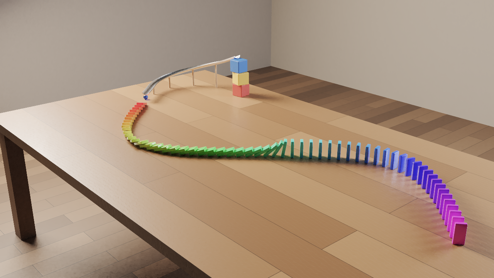
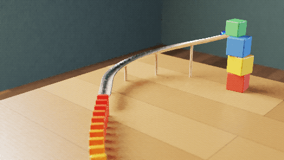

# Domino Cascade

An original rigid-body physics showcase built entirely through the editor's MCP server by
[`build.mjs`](build.mjs): a blue glass marble rolls down a curved aluminium chute that winds down
from a tower of toy blocks, shoots off the lip and knocks over the first of **60 rainbow-coloured
plastic dominoes** standing along an S-curve on an oak table. The whole chain topples in order,
the marble bounces back and comes to rest under the lip.

| | |
| --- | --- |
|  |  |

`contact_sheet.png` shows every 4th frame of the cascade (frames 4–96), `scene.glb` is the
baked, animated scene.

## The scene

All sizes are real-world metres, Z up.

* **Table** – `object.generate_table` (2.6 × 1.5 m, top at 0.75 m). Its top material is
  rewritten as satin oak boards: a `BRICK` procedural (one random tone per 1.3 m × 0.19 m
  board, hair-line seams) on the base colour plus a fine `WOOD` ring bump.
* **Dominoes** – 60 jumbo toy dominoes (80 × 40 × 14 mm, 47 g). One bevelled prototype
  (cube → `transform_apply` → `BEVEL` modifier applied → auto smooth) is copied with
  `object.array_place` (linked duplicates, rigid body copied along) and every copy is moved onto
  the S-curve `y = −0.35 sin(2π(x + 0.9) / 2)` with `object.transform_set` in one `batch`:
  equal 42.5 mm arc-length spacing (0.53 × height) and a Z rotation that follows the tangent.
  Each domino gets its own `glossy_plastic` preset material with a rainbow base colour.
* **Chute** – a 2D closed POLY curve (`Chute Profile`, a 3 mm thick 140° C-section of 22 mm inner
  radius) is used as the **bevel object** of a 3D Bezier path (`curve.add_from_points`, Z_UP twist)
  computed in the script: a 0.15 m lead-in leaving the tower, a 132° left-hand bend of 0.24 m
  radius and a straight run-out aligned with the first domino. Its height falls as `(1 − u)²`
  (steep at the top, level at the lip). `object.convert` turns it into a mesh, the profile curve
  is deleted. Satin aluminium material.
* **Supports** – three bevelled toy blocks carry the top of the chute, four beech dowels
  (`mesh.primitive_cylinder_add`, `wood` preset recoloured) carry the bend.
* **Marble** – 28 mm blue glass sphere (`clear_glass` preset, tinted), 29 g.
* **Room** – a dark walnut plank floor (`BRICK` procedural, plane rotated a quarter turn) and a
  plaster back wall.
* **Lighting** – a large warm area light on the left (its mirror highlight falls off the front
  of the table), a cool rim area light from the back right and a dim `STUDIO` environment;
  AgX view transform at −0.6 EV. 42 mm camera from the front right.

## Physics

| Object | Rigid body | Shape | Settings |
| --- | --- | --- | --- |
| Table | PASSIVE | CONVEX_HULL (its hull top is the table top) | friction 0.6, restitution 0.1 |
| Chute | PASSIVE | MESH (concave channel) | friction 0.4 |
| Dowels / blocks | PASSIVE | CYLINDER / BOX | stray-marble colliders |
| Floor | PASSIVE | BOX | |
| 60 dominoes | ACTIVE | BOX | 47 g, friction 0.5, restitution 0.1, margin 2 mm |
| Marble | ACTIVE | SPHERE | 29 g, friction 0.4, restitution 0.2, linear/angular damping 0.35 |

`rigidbody.world_set`: frames 1–100 at 24 fps, 20 substeps per frame (2.1 ms steps), 20 solver
iterations. The marble leaves the tower at frame 1, hits the first domino at frame ≈ 27 at
≈ 1.4 m/s about 75 % of the way up the domino; the wave runs at ≈ 1.2 m/s and the last domino
lands at frame ≈ 81.

`build.mjs` checks the simulation before baking: it samples `rigidbody.describe` every second
frame and requires that all 60 dominoes tilt past 45° **and** that they do so in path order
(it logs the frame at which each domino falls), renders inspection contact sheets of the marble
run (frames 1–31) and of the cascade (27–87) and spot-checks `get_object` world locations at a
few frames. Then `rigidbody.bake_to_keyframes` turns the motion of the 61 active bodies into
keyframes, and the script verifies that the baked keys reproduce the simulated positions.

## Rebuild

```bash
# start a server (any port), then:
MCP_URL=http://127.0.0.1:4504/mcp node examples/domino-cascade/build.mjs
```

The script deletes an existing `domino-cascade` project, rebuilds everything from scratch and
writes `render.png`, `contact_sheet.png`, `preview.gif` and `scene.glb` next to itself
(inspection sheets go to `$WORK_DIR`, default `$TMPDIR/domino-cascade-work`). `STAGES=scene,verify`
runs only part of it (stages: `scene, verify, inspect, bake, still, sheet, gif, export`, plus
`preview`); `STILL_SAMPLES` / `STILL_TIME_LIMIT` change the still's budget.

## Features and tools used

* **MCP tools:** `list_projects`, `delete_project`, `create_project`, `set_scene_settings`
  (frame range, resolution, engine, samples, bounces, denoising, view transform, exposure,
  environment), `run_operator` (with `selection`), `batch`, `add_modifier`, `apply_modifier`,
  `set_material`, `insert_keyframe` (`data.size` of the area lights), `delete_objects`,
  `get_object`, `get_scene`, `set_active_camera`, `render_image` (RASTER previews, PATHTRACER
  final), `render_animation` (CONTACT_SHEET, GIF), `export_scene` (glb).
* **Generators / layout:** `object.generate_table`, `object.array_place`, `object.transform_set`,
  `object.look_at` (camera and lights), `scene.raycast` (used while developing to check the
  channel orientation).
* **Curves:** `curve.add_from_points` (POLY profile, BEZIER path, `bevel_mode OBJECT`,
  `bevel_object`, `use_fill_caps`, `twist_mode Z_UP`), `object.convert` (curve → mesh).
* **Modelling:** `mesh.primitive_cube_add / cylinder_add / uv_sphere_add / plane_add`,
  `object.transform_apply`, `BEVEL` modifier, `object.shade_auto_smooth`, `object.shade_smooth`,
  `object.rename`.
* **Physics:** `rigidbody.object_add` (ACTIVE / PASSIVE; BOX, SPHERE, MESH, CONVEX_HULL,
  CYLINDER), `rigidbody.world_set`, `rigidbody.describe`, `rigidbody.bake_to_keyframes`.
* **Shading:** `material.preset_apply` (`glossy_plastic` ×60 with colour overrides, `wood`,
  `clear_glass`), `material.update`, `material.procedural_set` (`BRICK` boards and parquet,
  `WOOD` ring bump), `object.light_add` (AREA), `object.camera_add`.

## Render times

Measured on the shared 4-core test machine (load average ≈ 10–14 from other agents) with
`RENDER_WORKERS=2`:

RENDER_TIMES_PLACEHOLDER

## Known limitations

* **No depth of field:** the camera's `dof_use` (and the area lights' rectangular `shape`) cannot be
  set through MCP — light and camera data ids are not exposed and `data.set_property` cannot find
  them by name (reported as an issue). The area lights' sizes are set by keying `data.size` once.
* The marble is lighter than a domino, so it bounces back after the impact; linear/angular damping
  of 0.35 stands in for rolling resistance so that it comes to rest under the lip instead of
  rolling off the table.
* The physics engine has absolute tolerances tuned for objects of a few centimetres or more
  (2 mm contact slop, 5 mm minimum half-thickness of convex shapes, 3 cm/s sleep threshold), which
  is why the dominoes are jumbo-sized (14 mm thick) rather than real 7.5 mm ones.
* The contact sheet and GIF are path traced at only 4–6 samples per pixel with denoising, so they
  are softer and slightly blotchy compared with the still.
* `scene.glb` contains the baked keyframe animation of the 61 bodies; procedural materials are
  baked to 512 × 512 textures by the exporter, the area lights' sizes are not part of glTF.
