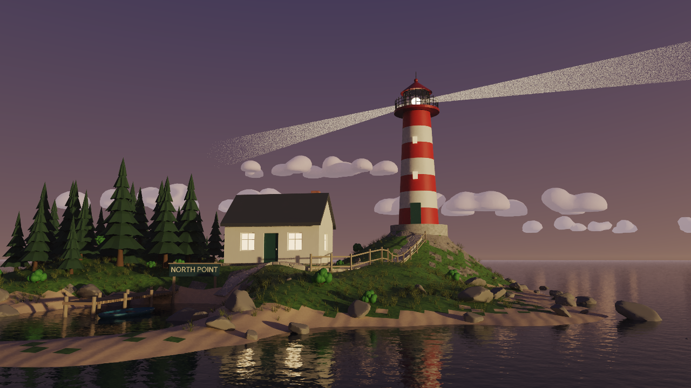
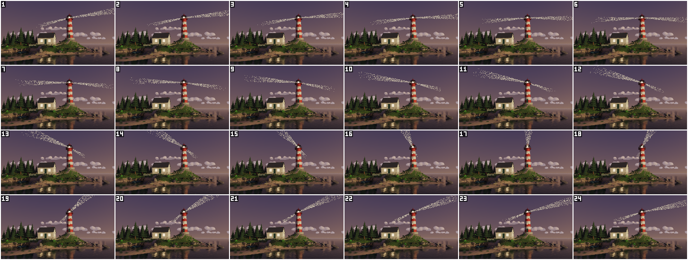
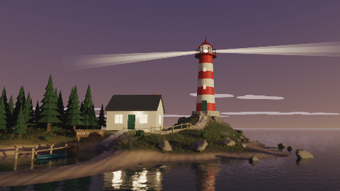
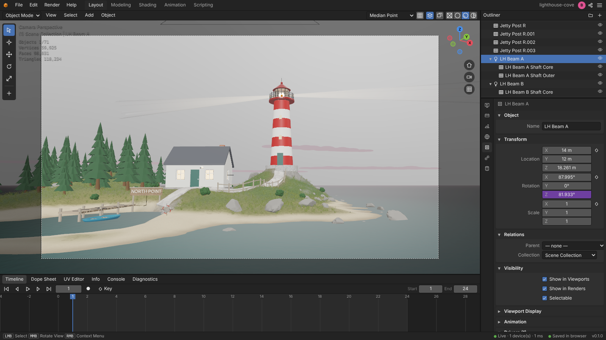

# Lighthouse Cove: "North Point"

An original coastal scene at dusk. An AI agent built it from nothing, using **only the editor's MCP
server**. `build.mjs` calls the same tools that any external agent gets: `run_operator`, `batch`,
`add_object`, `set_material`, `get_mesh_data`, `get_instances`, `get_object`, `render_image`,
`render_animation`, `export_scene` and others.



A small rocky island lies in a calm sea under a pink and violet twilight sky. A white lighthouse
with red bands stands on the headland. Its lantern glows, and two opposite beams sweep round over
the water. Below the lighthouse is the keeper's whitewashed cottage. Its windows are lit, warm
light falls on the ground in front of them, and a porch lamp burns by the door. A flagstone path
winds up from a sandy cove, past the cottage door, to the foot of the lighthouse, with a rail fence
on its seaward side; steps cut into the stone plinth climb the last metre to the lighthouse door.
A plank jetty and a rowing boat lie in the cove. A wooden sign at the head of the beach reads
**NORTH POINT**. Pines, bushes, rocks and dune grass are scattered over the island, but not on the
beach or the path. Thin cloud streaks lie low over the horizon.

| Beam sweep (24 frames, path traced) | Animated loop |
| --- | --- |
|  |  |

The outputs in this folder:

- `render.png`: the final still, 1280×720, path traced and denoised.
- `contact_sheet.png`: the 24 frames of the beam sweep, path traced.
- `preview.gif`: the same 24 frames as a seamless loop, 480×270 at 10 fps.
- `scene.glb`: the scene as glTF 2.0 binary, with the beam animation (see [scene.glb](#sceneglb)).
- `editor.png`: the project open in the web editor (see [In the editor](#in-the-editor)).
- `build.mjs`: the reproducible build.

## Rebuild

From a clone of the repository, build and start the editor server (it listens on port 8080),
then run the build against it:

```bash
npm ci && npm run build && npm start
MCP_URL=http://127.0.0.1:8080/mcp node examples/lighthouse-cove/build.mjs [mode]
```

The modes:

- no mode: the full run. It builds and checks the scene, then renders `render.png`,
  `contact_sheet.png` and `preview.gif` into this folder. It does not export `scene.glb`. It
  takes about 12 minutes with 3 render threads (see [Final production run](#final-production-run)).
- `--build-only`: the scene and the checks only (3–5 s).
- `--preview`: the scene and the checks, then a RASTER preview and a 16-spp path-traced preview
  (640×360) in `$TMPDIR/lighthouse-cove-preview`; nothing is written next to `build.mjs` (about
  50 s with one render thread).
- `--export-only`: the scene and the checks, then `scene.glb`, no renders (15–25 s).

The flags:

- `--skip-final` skips the still.
- `--skip-anim` skips the animation.
- `--export` also exports `scene.glb` after the renders.
- `--out <dir>` writes the outputs to another folder (for example `--export-only --out /tmp/x`).
- `--keep` makes the script fail instead of deleting an existing project.

The script deletes any project called `lighthouse-cove`, creates it again empty, builds the whole
scene and checks it. Any tool error stops the build, and so does any operator WARNING, because a
warning means that some input was ignored. So does any failed check (next section). The layout
and the main design numbers are constants at the top of `build.mjs`: the terrain, the sculpt
strokes, the path waypoints, the steps, the fence spacing, the scatter settings, the camera, the
sun, the mist and the beam phase. The details (object sizes, colours, light energies, the cloud
streaks) are written where each part is built.

## The brief, element by element

| Requested | How it is built | Checked by |
| --- | --- | --- |
| Small rocky island | `object.generate_terrain` (64 m, 129² vertices, FBM noise, `island_falloff: 1`). Then `sculpt.brush_stroke` GRAB strokes raise the headland and the western hill and carve the cove, and FLATTEN dabs even out the building pads | `get_mesh_data` heightmap (−1.4 … 5.5 m) |
| Sand / grass / rock materials | `material.preset_apply` grass, rock and sand give each zone its own procedural texture, bump and roughness. Their colours are set to neutral greys with `material.procedural_set`, and the hue comes from **vertex colours**. A colour is computed for every vertex from its height above the sea, the slope and the distance to the path and buildings, with smooth noise breaking up the boundaries: a chain of blends from lush grass to dry grass, worn earth, rock (a mix of two greys) and sand (a mix of dry and wet sand). One `paint.vertex_color_set_data` call writes all 16,641 colours. The faces get a material slot from the average weights of their corners (`edit_mesh` + `object.material_slot_assign`), while the colour blends smoothly across the faces | `get_mesh_data {include: colors}`: all 16,641 vertex colours read back equal the computed ones |
| Calm sea | A 600 m plane with the `water` preset, made opaque and glossy (`material.update`), with a lighter teal SPHERICAL `GRADIENT` over the shallows | Visual |
| White lighthouse with red bands | Primitives (`add_object` cylinder, cone, uv_sphere, cube) plus a closed RAIL `object.generate_fence` for the gallery railing. The bands are one `WAVE` texture (BANDS along Z, CONSTANT ramp) in object space | Visual |
| Glowing lamp room | An emissive lamp, a warm POINT light and **refracting lantern glass** (transmission 1, IOR 1.45) with a faint warm glow. The path tracer passes the lamp light through the glass to the gallery, the railing and the roof, and the solid glass cylinder magnifies the lamp like a lighthouse lens | Path-traced crop |
| Keeper's cottage, GABLE roof | `object.generate_building {roof: GABLE, materials: false}` with our own materials in its five slots, on a stone foundation, with a brick chimney | Visual |
| Lit windows | One **RECTANGLE area light** per window, sized to the pane. The panes are found with `get_mesh_data {face_materials, face_centers, face_normals}` on the generated building, and the lights are added with `object.light_add {type: AREA, shape: RECTANGLE, size, size_y}` in one `batch`. A small porch lamp has its own POINT light | Path-traced crop |
| Winding stone path, with bevel, dropped onto the terrain | `curve.add_from_points` BEZIER with a 1.5 m flat profile (`bevel_mode: OBJECT`). The waypoints are resampled every 0.8 m and **dropped onto the ground** with batched downward `scene.raycast`s. Two more ray casts 0.7 m to the left and right of each point set a per-point **tilt**, so the path banks with the cross-slope. The flagstones are two VORONOI textures, CELL colour and DISTANCE_TO_EDGE bump. The headland falls about 1 m per metre in front of the lighthouse, so the path stops at the plinth and **steps cut into the plinth** lead to the door: a hidden box cuts a notch out of the plinth (`add_modifier` BOOLEAN DIFFERENCE) and four step blocks fill it (`object.transform_apply`, `object.join`, `object.rename`): 5 rises of 0.20 m and treads of 0.26 m from the top of the path end to the door sill | `get_mesh_data` of the evaluated path against the island heightmap: the highest point is 0.28 m above the ground (the build fails above 0.4 m) |
| Fence along part of it | `object.generate_fence {points: [x, y, z], materials: false}` 1.05 m to the seaward side of the upper path. Every post stands on a ray-cast ground height, sunk 0.1 m: the 13 fence points are at most 1.9 m apart, less than `post_spacing` (2.0 m), so the generator puts a post on each point and adds none in between | One-off (not part of `build.mjs`): the 13 posts split out of the evaluated fence mesh, with `scene.raycast` at the four corners of each post: every corner is 0.05–0.15 m below the ground |
| Conifers, rocks, grass tufts, kept off the beach and the path | `object.generate_tree {CONIFER}` ×3, `generate_rock` ×3, `generate_grass_tuft` ×2 and `generate_bush` as sources. Per-vertex density maps are written as vertex groups (`object.vertex_group_set_weights`). Every vertex of the dry beach (sand faces above the waterline), the path, the building pads and the sign gets weight 0. Trees grow on the western hill and the northern slopes. Rocks lie along the shoreline, standing in the shallows, and on steep ground. Grass tufts grow all over the land and are densest just above the sand. They are scattered with `object.scatter_add {vertex_group, min_distance}`: 40 pines, 100 rocks, 2,600 tufts and 30 bushes | **Placement check** in `build.mjs`: `get_instances` lists the world location of every instance. Closest pairs: pines 2.61 m (min_distance 2.6), rocks 1.38 m (1.3), tufts 0.32 m (0.32), bushes 2.22 m (2.2). None stands on the path or the dry beach; 48 of the rocks stand in the shallows |
| Wooden sign "NORTH POINT" on a post | A board on two posts, parented to an empty that is turned to face the camera. The letters are `object.text_add {body: "NORTH POINT", extrude}`. The wood grain is a distorted WAVE texture, applied after `object.transform_apply` of the board's scale | Visual |
| Sunset sky with a low sun, light mist | `world.sky_set {preset: SUNSET, sun_elevation: 0.04, sun_rotation: 4.22}` with custom zenith and horizon colours, and `world.mist_set {distance: 800}` (95 % at 800 m: the island stays clear, the far sea and the clouds fade into a lavender haze). The sun is behind the camera, low on the right, and lights the tower warm; the sky ahead is the pink and violet twilight side. Four thin cloud streaks, 350–600 m long and 6–9 m thick, come from `object.generate_cloud` at their full size (64 puffs that merge softly give them a bumpy upper edge). At 0.8–1 km the mist covers 96–99 % of a cloud's own shading, so they simply glow in the mist colour | Visual |
| Rotating beam: a spot light driven from the frame | Two opposite SPOT lights (`add_object {type: light, light_type: SPOT}` with `spot_size`, `spot_blend`, `shadow_soft_size`). Each has an `anim.driver_add` on `rotation_euler[2]` with the expression `phase + (frame - 1) * pi / 24`: half a turn in 24 frames, so the pair loops seamlessly. The visible shafts are explained below | `get_object {frame}` at frames 1, 7, 13, 19 and 25. The evaluated heading of beam A is 81.9°, 126.9°, 171.9°, 216.9° and 261.9° (7.5° per frame), and frame 25 equals frame 1 with the beams swapped |
| Camera aimed with TRACK_TO at an empty near the lighthouse | `add_object empty` ("Camera Target") **on the lighthouse's axis**, 2.4 m above the door sill, + `object.constraint_add {type: TRACK_TO, target}` + `set_active_camera`. A **lens shift** (`shift_x` −0.105, `shift_y` 0.011, passed to `add_object camera`) moves the frame so that it is centred on a point between the cottage and the tower: the camera stays aimed at the lighthouse, which stands right of centre, and the cottage and the pines fit in. The shift is computed in `build.mjs` from the camera, target and centre positions | The camera's evaluated `world_transform` from `get_object` aims 0.002° off the target. Projected with it and the lens shift, the frame centre point lands at pixel (640.0, 360.0) of the 1280×720 frame and the lighthouse axis at (774, 374) |

**The beam shafts.** The path tracer has no volumes, so the light of the beams in the mist is
faked. Each beam has two nested open cones (`add_object cone`) parented to the spot light. The
cones are made of **index-matched glass**: transmission 1, IOR 1, roughness 0, white. Camera rays
and light pass straight through them, so they cast no shadow, and camera rays pick up their
emission. The emission is a QUADRATIC_SPHERE `GRADIENT` on the emission channel, so the shaft
fades out with distance. The glow is added deterministically, so the shafts are free of noise even
at a few samples per pixel, and the mist of whatever is seen through them is kept.

## In the editor



The project open in the web editor (`http://127.0.0.1:8080/?project=<id>`; the build prints the
link), seen through the scene camera in Material Preview, captured with Playwright Chromium at
1600×900. Beam A is selected: the Object properties show its Z rotation in purple because a
driver sets it. The outliner lists the beam's two shaft cones under it.

## scene.glb

`--export-only` (or `--export`) writes `scene.glb` with `export_scene {format: glb, objects,
bake_resolution: 512}`. The export runs on a server render thread and takes 10–20 s. It holds every
object the renders show except the four cloud streaks: they are flat shapes 0.8–1 km away that glow
in the mist colour and only read through the world mist, which glTF cannot carry (nor the sky).
Leaving them out keeps the file under 6 MB (5.85 MB; with the clouds it would be 7.7 MB) and lets a
viewer that frames the whole scene frame the island and the 600 m sea rather than a 2 km box of sky.
The procedural textures are baked at 512 × 512 pixels: at the exporter's automatic size (about
64 texels per metre, which gives 2048 pixels for the island's ground and rock textures) the file
would be 26 MB.

What the file contains:

- 56 objects of the scene: the island (vertex colours as `COLOR_0`), the sea, the lighthouse, the
  cottage, the path, the fence, the steps, the sign, the jetty and the boat, the beam shafts, the
  10 lights (`KHR_lights_punctual`) and the camera.
- The 2,770 scattered pines, rocks, tufts and bushes as nodes that share 9 meshes. The whole
  file has 2.6 M triangles.
- 34 materials. The procedural textures are baked into 24 PNG images. `Jetty Planks` and
  `Lighthouse Stone` are baked once per mesh that uses them, because their textures depend on the
  surface, so they appear twice (the copies are named `Jetty Planks.001` and
  `Lighthouse Stone.001`). The lantern glass and the beam shafts use `KHR_materials_transmission`
  and `KHR_materials_ior`, and the lamps and the lit windows `KHR_materials_emissive_strength`.
- One animation, `Scene`: the driven heading of both beams, sampled once per frame (24 keys at
  24 fps, 0–0.958 s). The clip ends on frame 24, so a player that loops it goes from frame 24
  straight back to frame 1 (which looks like frame 25, since the two beams are alike) without
  holding frame 24 for 1/24 s.

The export warnings:

- `Camera 'Camera': lens shift cannot be exported to glTF`: the glTF camera is centred on the
  lighthouse, not on the point between the cottage and the tower.
- `Area light 'Cottage Window Light 1' exported as a point light`, and the same for window lights
  2 to 6.
- `Mesh 'LH Plinth': its UVs overlap (17% of the UV layout is used by more than one face): generated
  UVs (Smart UV Project) replace them to bake the procedural textures of 'Lighthouse Stone'`, and
  the same for `LH Steps` (100 %) and for `Stone Path` (100 %, `Path Stones`). The exporter unwraps
  these meshes itself, so every face gets its own part of the baked images.
- `Material 'Jetty Planks' is exported as 2 glTF materials (Jetty Planks, Jetty Planks.001): its
  procedural textures depend on the surface (GENERATED/OBJECT mapping or a bump), so they are baked
  for each mesh`, and the same for `Lighthouse Stone`.

Checked with the repository's glTF validator (`packages/core/test/fixes-export-gltf-check.ts`:
no problems) and with three.js r187 `GLTFLoader` in headless Chromium: the file loads without
console messages (2,889 meshes, 8 point and 2 spot lights, 1 camera, 34 materials, 24 textures)
and the `Scene` clip turns the beams 7.5° per frame, as in the editor. It has no skins and no
morph targets, because the scene has none.

## Editor features this project exercises

- **Generators**: terrain, building (GABLE), fence (open path with z values, and a closed ring),
  conifer trees, rocks, grass tufts, a bush and clouds. Every generator whose default materials
  would be replaced runs with `materials: false`, so the project has no unused materials.
- **Sculpting**: GRAB and FLATTEN with `sculpt.brush_stroke`.
- **Vertex colours**: `paint.vertex_color_set_data` writes computed per-vertex colours in one
  call. The renderers multiply the material base colour, including a procedural one, by the
  vertex colours.
- **Geometry read-back**: `get_mesh_data` for vertices, faces, face materials, face centres and
  normals in world space, vertex colours, the evaluated surface of a curve, and heightmaps.
- **Mesh editing**: `edit_mesh` with face selections (`object.material_slot_assign`) and vertex
  selections (`mesh.delete` turns a UV sphere into the boat hull), Boolean, Solidify, Wireframe
  and Smooth by Angle modifiers, `object.transform_apply`, `object.join`, `object.rename`,
  `object.shade_smooth`.
- **Materials**: presets, procedural textures (WAVE, VORONOI, GRADIENT, BRICK and NOISE presets)
  on the base_color, normal and emission channels, emission, and transmission (refracting and
  index-matched glass).
- **Lights and cameras by name**: every light setting is passed straight to `add_object` or
  `object.light_add`, including spot cone, blend, radius and area shape and size. The camera
  gets `lens`, `sensor_width`, `clip_end` and the lens shift.
- **Curves and text**: a bevel profile object, per-point tilt, `data.set_property` to hide the
  profile helper and the Boolean cutter, and extruded text.
- **Instancing**: `object.scatter_add` with vertex-group density and `min_distance`,
  `get_instances` for the placement check, and `object.array_place` for the jetty posts.
- **Animation**: `anim.driver_add`, with evaluated values checked through `get_object {frame}`.
- **Constraints**: TRACK_TO.
- **World**: `world.sky_set` (the SUNSET preset with a low sun and custom zenith, horizon and
  ground colours) and `world.mist_set`.
- **Scene queries**: batched `scene.raycast`, plus `get_scene` counts, material users and
  `problems`.
- **Rendering**: `render_image` with the path tracer (ACES, denoise, time limit) and RASTER, and
  `render_animation` CONTACT_SHEET and GIF, path traced and denoised.
- **Export**: `export_scene {format: glb, objects}`.

The MCP tools it calls: `list_projects`, `delete_project`, `create_project`,
`set_scene_settings`, `run_operator`, `batch`, `add_object`, `transform_object`, `set_parent`,
`set_material`, `add_modifier`, `edit_mesh`, `get_mesh_data`, `get_instances`, `get_object`,
`get_scene`, `set_active_camera`, `render_image`, `render_animation` and `export_scene`.

Scene size: 71 objects (55 meshes, 2 curves, 1 text, 10 lights, 2 empties, 1 camera; the Boolean
cutter, the path profile and the 9 scatter sources are hidden from renders). The objects that
render have 60k vertices and 98k faces evaluated (118k triangles), and the 11 hidden ones another
5.5k vertices (`get_scene` lists them under `not_rendered`). The 2,770 scattered instances add
2.5 M triangles. There are 33 materials, all in use, and 2 drivers.

## Final production run

The final production run used a fresh editor server with an empty data directory and 3 render
threads, and ran the whole `build.mjs` in its default mode. It also proves that the project
rebuilds from scratch:

```bash
PORT=4561 DATA_DIR=<new empty dir> RENDER_WORKERS=3 npm start &
MCP_URL=http://127.0.0.1:4561/mcp node examples/lighthouse-cove/build.mjs
```

Measured on 2026-11-06. The run held the render lock from 17:04:05 to 17:16:06 (UTC), and the
machine's 4 cores were shared with other agents (load average 4–16). Exit code 0:

| Stage | Settings | Time | Result |
| --- | --- | --- | --- |
| Build and checks | the whole scene, then the material, beam, path, colour, camera and placement checks | 3.1 s | all checks passed (island 0.8 s, checks 0.4 s) |
| Final still `render.png` | 1280×720, path tracer, 128 spp, 8 bounces, denoise, ACES, time limit 480 s | 371.8 s | **128 of 128 spp**, 3 threads, 0.63 MB |
| `contact_sheet.png` | 24 frames, 320×180 each, 6 columns, path tracer, 12 spp, denoise | 56.1 s | 24 frames, every frame at 12 spp, 1.04 MB |
| `preview.gif` | 24 frames, 480×270, 10 fps, path tracer, 16 spp, denoise, Floyd–Steinberg dither | 288.7 s | 24 frames, every frame at 16 spp, 0.96 MB |
| **Total** | | **719.7 s (12.0 min)** | |

The saved project (`document.ybin` in the server's data directory) is 6.6 MB. `editor.png` comes
from a project built with `--build-only` on the same editor code. `scene.glb` comes from an
`--export-only` run on the final code (2026-11-07, after the last fixes to the exporter; export
11 s, whole run 15 s). A preview path-traced on that code (640×360, 24 spp) matches `render.png`,
so the renders were kept.

## Known limitations

- **The spot lights light almost nothing visible.** The beams point out to sea and pass over the
  island, and the path tracer has no participating media, so the visible beams are the emissive
  glass shafts described above. The spot lights exist and turn as the brief asks, and their light
  passes through the shafts, but it meets the sea only 100–500 m out, at a grazing angle, where
  the dark, glossy water shows next to nothing of it.
- **The sea is opaque.** Clear water would show the square border of the terrain 0.6 m under the
  surface. The sea therefore shows reflections plus a teal tint over the shallows, without real
  shallow-water transparency.
- **The ground zones switch per face.** The colours blend smoothly, through vertex colours, but
  the texture and bump of the grass, rock and sand materials still change at face edges of the
  0.5 m grid. At this camera distance the change is not visible.
- **The path still floats slightly in places.** It is banked with the ground, but on the steep
  final stretch below the lighthouse it floats up to 0.28 m above the terrain, against 0.11 m for
  a perfect fit.
- **Depth of field is not used.** With a 26 mm lens, focus on the lighthouse about 48 m away and
  everything else 11–60 m away (and the clouds far beyond), the circle of confusion stays at about
  one pixel or less even at f/1.4, so `camera.properties_set {dof}` would have no visible effect
  on this wide shot.
- **`scene.glb` is a reduced variant.** It leaves out the clouds, and glTF has no sky, mist or
  lens shift; the window area lights become point lights (see [scene.glb](#sceneglb)).
