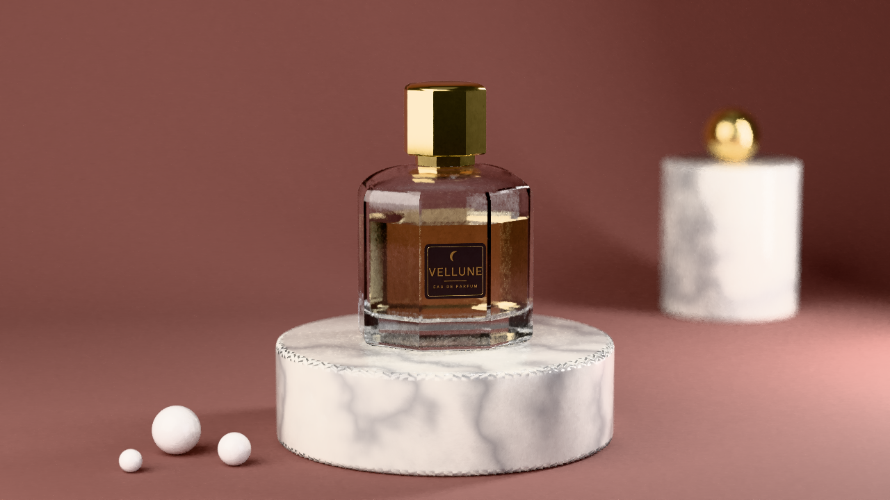

# Vellune: a perfume product shot built through MCP



An original product visualisation of an invented eau de parfum called **Vellune**. The name and
the crescent-moon emblem are made up for this scene ("lune" is French for moon). It does not
depict any real brand or product. Every object, material, light, the camera, the animation and the
renders were made by [`build.mjs`](build.mjs) calling the editor's MCP server, the same way an
external AI agent would. The script only does arithmetic (profile points, label layout) and saves
the files the server returns.

| File | What it is |
| --- | --- |
| `build.mjs` | Reproducible build: deletes and recreates the `product-shot` project, builds the scene, renders the outputs and exports the glTF |
| `render.png` | Final still, 1280×720, path traced and denoised |
| `contact_sheet.png` | Turntable check: 12 of the 36 loop frames, path traced |
| `preview.gif` | The full 36-frame turntable loop, 384×216 at 12 fps, path traced at low samples |
| `scene.glb` | glTF 2.0 export of the scene (modifiers applied, turntable animation included) |

## The scene

Everything is built at real-world scale (metres, Z up). The bottle is about 9 cm wide and 13 cm
tall with its cap.

* **Bottle.** A thick-walled glass flacon with an elongated octagonal cross-section. Its
  wall/base profile (outer wall, domed shoulder, neck, inner cavity, thick glass base) is a POLY
  curve (`curve.add_from_points`) converted to a mesh (`object.convert`) and revolved by a
  **SCREW** modifier with 8 steps. The 8 steps make the facets. The profile lies in the plane at
  22.5° so a flat facet faces the camera, and the object is scaled 1.2× along X to widen that
  front facet for the label. A **SMOOTH_BY_ANGLE** modifier keeps the facet edges sharp and the
  shoulder curvature smooth. The glass is a slightly blue-tinted transmissive material with
  IOR 1.5.
* **Perfume.** A second revolved profile that follows the cavity with a 0.4 mm air gap. The
  liquid is champagne-coloured (transmission, IOR 1.36).
* **Cap.** A stepped octagonal cap revolved the same way, with facets aligned to the bottle. It
  uses the `gold` preset, polished to roughness 0.14.
* **Front label.** Six curve and text objects, created in a single `batch`:
  * a black enamel plate: a filled, extruded 2D rounded rectangle with a clear coat;
  * a gold frame: a closed curve with a round `bevel_depth`;
  * a crescent emblem: a filled 2D curve;
  * the name **VELLUNE** and **EAU DE PARFUM**: extruded FONT objects;
  * a gold rule between the two lines.

  The label pieces are parented to the bottle.
* **Pedestal and props.** A bevelled marble plinth, using the procedural `marble` preset re-scaled
  with `material.procedural_set`. A marble column with a gold sphere stands behind on the right,
  and three porcelain "pearls" lie on the floor in front.
* **Cyclorama.** A seamless studio sweep: an open 2D curve (floor → 26 cm cove → wall) whose
  `extrude` turns it into a 1.6 m wide sheet. The paper is a matte dusty rose.
* **Lighting.** Three area lights:
  * a large warm **key** softbox front-left (0.75 × 0.85 m);
  * a cool **fill** panel front-right;
  * a narrow **rim** strip side-back for the glass edges.

  The STUDIO environment at strength 0.2 adds subtle reflections. The view transform is
  **Khronos PBR Neutral**, which keeps product colours faithful.
* **Camera.** 85 mm lens at about 1.05 m. **Depth of field** at f/4 is focused on the label plane,
  so the column, the pearls and the backdrop fall off softly.
* **Turntable.** `anim.turntable` orbits the *same* camera around the bottle. Its radius, height
  and start angle reproduce the still, so frame 1 is the still. The backdrop, lights and props
  are parented to the "Turntable Pivot" and turn with the camera. On screen, the bottle and its
  pedestal spin while the studio stays put, like a real product turntable. The loop is 36 frames
  long and seamless (CYCLIC extrapolation).

## Features, operators and tools used

* **MCP tools:**
  * project lifecycle: `list_projects`, `delete_project`, `create_project`;
  * scene and objects: `set_scene_settings`, `add_object`, `add_modifier`, `set_material`,
    `set_active_camera`;
  * operators: `run_operator`, `batch`;
  * checks and output: `get_scene` (problems check), `render_image` (PATHTRACER),
    `render_animation` (CONTACT_SHEET and GIF), `export_scene` (glb).
* **Curves and text:** `curve.add_from_points` covers POLY curves in 2D and 3D, `cyclic`,
  `fill_mode`, `extrude` and `bevel_depth`. Text uses `object.text_add`, and `object.convert` turns
  curves into meshes.
* **Modifiers:** SCREW (lathe), SMOOTH_BY_ANGLE and BEVEL.
* **Shading:**
  * presets via `material.preset_apply` (gold, marble, porcelain);
  * procedural textures via `material.procedural_set` (the MARBLE texture);
  * new materials and edits via `material.new` and `material.update` (clear coat);
  * assignment via `object.material_assign`;
  * transmission and IOR via `set_material`.
* **Layout and look:** `object.look_at` aims the lights and the camera; `object.shade_smooth` and
  `object.shade_auto_smooth` set shading.
* **Data:** `data.set_property` sets the area light shape and size and the camera DOF (see
  limitations).
* **Animation and rigging:** `anim.turntable` and `object.parent_to`.
* **Rendering:** the path tracer with denoising, `max_bounces` 10, a time limit, DOF and the
  NEUTRAL view transform.

## Rebuild

Start a server (any data dir), then run the script from the repository root:

```bash
PORT=4505 DATA_DIR=/tmp/ps-data RENDER_WORKERS=2 node .phase3/app/dist/main.js &
MCP_URL=http://127.0.0.1:4505/mcp node examples/product-shot/build.mjs
```

`MODE` selects what runs:

| `MODE` | Runs |
| --- | --- |
| `full` (default) | Build, then the still, the turntable renders and the export |
| `build` | The project only |
| `preview` | Build plus quick 480×270 previews in `PREVIEW_DIR` |
| `still`, `anim`, `export` | Build plus that one output |

`OUT_DIR` redirects the outputs. `FINAL_SAMPLES` and `FINAL_TIME` override the still's samples
and time budget.

RENDER_TIMES_PLACEHOLDER

## Known limitations and workarounds

LIMITATIONS_PLACEHOLDER
