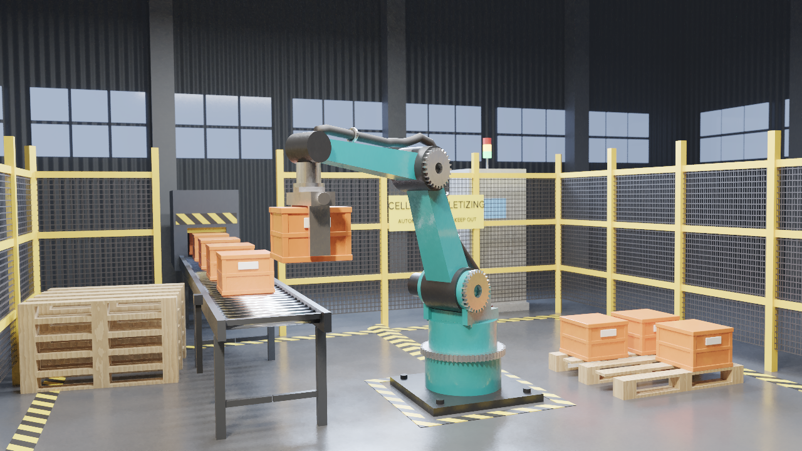
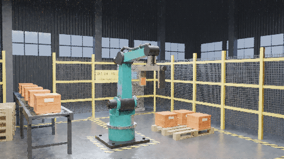
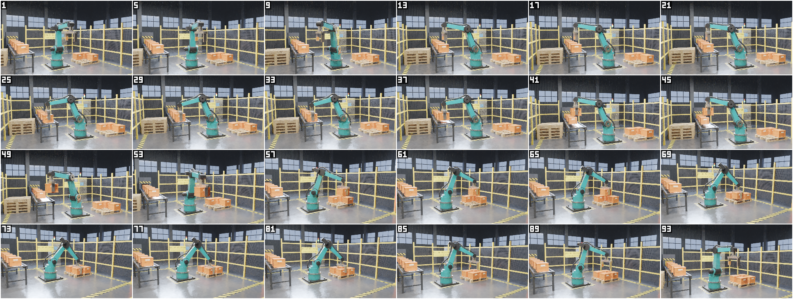
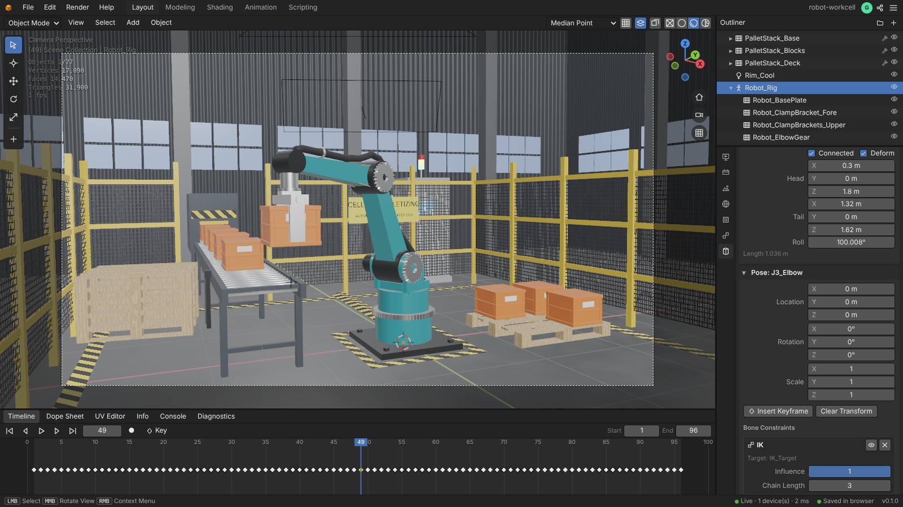

# Robot palletizing workcell ("Cell 04")

An original industrial pick-and-place cell, built entirely through the editor's MCP server by
[`build.mjs`](build.mjs). A teal four-axis palletizing robot lifts a plastic crate off the end of a
roller conveyor, swings it through the front of the cell and sets it into the last free slot of a
pallet. Meanwhile the conveyor moves the queue one place forward, and the next crate rolls out of
an infeed hood through a roll-up door. The cell also has a welded-mesh safety fence, hazard-striped
floor markings, a light curtain, an E-stop station, a stack of empty pallets and a controller
cabinet with a signal tower. It stands in a dim factory hall.







Every file in this folder comes from this repository's editor and `build.mjs` (see
[Final production run](#final-production-run)):

- `render.png`: the still, 1280 × 720, frame 49, path traced and denoised.
- `contact_sheet.png`: every 4th frame of the cycle (1–93), path traced.
- `preview.gif`: the cycle as 48 path-traced frames at 12 fps.
- `scene.glb`: the rigged, animated scene (see [scene.glb](#sceneglb)).
- `editor.png`: the project in the web editor (see [In the editor](#in-the-editor)).

## What is in the scene

| Part | How it is made |
| --- | --- |
| Robot rig | `object.armature_add` + `armature.bone_update` (J1_Base) + `armature.chain_add` (J2_Shoulder, J3_Elbow, J4_Wrist; `align_roll: [0, -1, 0]` turns every arm bone's Z axis to the front, so the Z axes of J2 and J3 are their joint axes): **J1** yaws about Z, **J2 / J3** pitch, **J4** rolls the gripper about the vertical. J1–J3 form one IK chain with per-bone IK locks (see IK). |
| Rigid parts | 18 parts: turret with shoulder yoke, motors, joint housings, tapered arm segments, wrist flange, gripper, three gears, three hose clamps and two clamp-bracket meshes. They are made with `object.add_mesh_from_data`, `object.generate_gear` and `mesh.primitive_torus_add` and bone-parented like Blender's Ctrl+P > Bone: `object.select` (parts + armature active), then `object.parent_set {type: BONE, bone}`. The elbow bends between 78° and 127° in the cycle, and its layout is chosen so that nothing collides over that range: the forearm starts inside the 0.16 m elbow housing, and the rear elbow motor sits beside the arm's centre plane. As a result, apart from the joints themselves (each link ends inside the round housing of its joint), no link, motor or hose passes through another part at any frame (the build checks this, see Verification). The base plate and pedestal are plain children of the rig. |
| Gears | `object.generate_gear`: a 60-tooth slewing ring on J1 and gear wheels on the shoulder and elbow, bone-parented so they turn with their joints. `materials: false`, because the parts get their own materials (otherwise the generator would leave an unused default "Steel" material behind). |
| Dress-pack hose | `object.generate_pipe` along a path that runs up the back of the upper arm, around the back of the elbow next to the elbow motor and along the top of the forearm. It is bound with `object.parent_set {type: ARMATURE_AUTO}` (automatic bone-heat weights + Armature modifier), so it bends with J1, J2 and J3. On a hose that runs 17 cm from its bones, the automatic weights blend over long stretches. With the raw weights, the hose root (55 % J1_Base, 42 % J2_Shoulder) slid up to 112 mm over its fitting, and the hose moved up to 36 mm out of the centre of its clamps. The build therefore reads the weights with `get_mesh_data` and pins each clamped stretch to the bone of its link: root → J1_Base, upper-arm clamps → J2_Shoulder, forearm → J3_Elbow. Each pinned stretch blends back into the automatic weights over 12–15 cm, so the automatic weights still bend the hose at the shoulder and around the elbow. The fixed weights are written back with `object.vertex_group_set_weights`. Three clamps on brackets hold the hose to the arm. |
| IK | `pose.ik_add` on J3_Elbow with a **three-bone chain** (J1_Base → J2_Shoulder → J3_Elbow) that reaches the keyframed empty `IK_Target`. **Per-bone IK locks** (`pose.ik_settings_set`, Blender's `lock_ik_*`) make it a palletizer: J1 may only turn about its own Y axis, the vertical (`lock_ik_x`, `lock_ik_z`), J2 and J3 only about their Z axes, the joint axes (`lock_ik_x`, `lock_ik_y`). So the IK turns the base towards the target and keeps the arm in the vertical plane through it. **IK limits** (`use_ik_limit_z`) hold the shoulder within −50…30° and the elbow within −35…60° of the rest pose (the cycle uses −28…8° and −11…38°), so the solver cannot swing the arm over the top or flip the elbow. Like Blender's, the solver starts from the pose, so J1 is posed (not keyed) at the home azimuth of 270° with `pose.bone_transform_set`: every target of the cycle lies within 90° of it. From the rest pose, the pick station lies straight behind the arm, where the yaw has no direction to start in: without the start pose, the base does not turn round and the wrist misses the pick station by 2.4 m (without the limits, the arm reaches back over the top instead). `pose.constraint_add DAMPED_TRACK` on J4 aims at `Wrist_Aim` (a child of the target, 1 m below it), which keeps the wrist vertical like a palletizer's parallel link. The web editor shows the locks and limits of the active bone in its Inverse Kinematics bone panel, and `armature.describe` lists them (`ik_settings`). |
| Gripper fingers | One mesh with a `Grip` shape key (`object.shape_key_add` + `object.shape_key_set_positions`) that moves both fingers 58 mm inwards. `insert_keyframe shape_keys["Grip"].value` keys it open → closed → open. |
| Carry | A `CHILD_OF` constraint (`object.constraint_add`) on the crate targets bone J4_Wrist, with keyed influence: 0 → 1 when the fingers have closed, 1 → 0 at the release. The crate's own location is keyed at frame 1 (pick station) and, at the release frame, at the place position read back with `constraint.describe`. |
| Conveyor | One roller with an **ARRAY** modifier (51 rollers), one leg with **MIRROR + ARRAY**, side frames, an end stop, a drive box and a photo-eye sensor. At the far end, outside the fence, stands an infeed hood with a hazard band and a roll-up door. The door's Z location has smooth BEZIER keys: it opens at frames 45–51 and closes behind the emerging crate at 58–64. Nine crates are linked duplicates (`duplicate_object linked`) of one ribbed tote mesh with a BEVEL modifier: six on the belt (one of them waiting unseen inside the hood) and three on the pallet. |
| Pallets | One deck board, one block and one base board each, multiplied by ARRAY modifiers (5 boards, 3 × 3 blocks, 3 base boards). The stack of empty pallets adds a Z ARRAY. Wood comes from `material.preset_apply wood`, re-coloured with `material.procedural_set`. |
| Floor | Dark epoxy with a NOISE base colour and roughness. **Procedural safety stripes**: a WAVE texture (BANDS, DIAGONAL, SAW profile, CONSTANT ramp) on the hazard border, the robot danger zone, the cable protector and the infeed's hazard band. |
| Safety fence | `object.generate_fence` makes two RAIL runs that leave a gap for the conveyor. The welded-mesh infill panels are thin boxes whose alpha is a procedural BRICK texture without row offset (mortar = wire, bricks = holes, blend CLIP). The panel edges sit where the 5 cm wire grid cannot leave loose wire ends: the top edge inside the generated top rail, the side edges inside the posts and the bottom edge on a full wire. |
| Props | `object.text_add` signs ("CELL 04 - PALLETIZING", "AUTOMATIC MACHINE - KEEP OUT"), a controller cabinet with an emissive HMI and a signal tower, a light curtain, an E-stop station and a striped cable protector. The tower's amber lamp blinks through `anim.driver_add` on the material's `emission_strength` (`14 * (fract(frame / 12) < 0.5)`). |
| Hall | North, west and east corrugated walls (a WAVE bump on the normal channel; the side walls use a second material with the waves along Y), glowing window strips and steel columns. |
| Camera | `object.camera_add` (30 mm) + `object.look_at`. A **DAMPED_TRACK** constraint (`TRACK_NEGATIVE_Z`, influence 0.5) on `Robot_Gripper` makes the camera pan after the gripper between conveyor and pallet. **Depth of field** with `camera.properties_set {dof_use, dof_focus_object: Robot_Gripper, dof_aperture_fstop: 2.8}` keeps the gripper in focus at every frame (focus distance 3.90–5.65 m). |
| Lighting | `object.light_add` with area-light shapes and sizes: two 4.2 × 0.45 m **RECTANGLE** LED strips over the cell, a cool 3 × 1 m RECTANGLE rim light behind the robot and a warm **SPOT** key (`spot_size`, `spot_blend`, `shadow_soft_size`) from the front left. Also a dark world colour, mist (`set_scene_settings mist_distance`), the AgX view transform and emissive windows. |

The scene has 77 objects (67 meshes), 28 materials (each one used) and 31 900 render triangles.

## Animation (96 frames, 24 fps)

The script computes the IK target path in cylindrical coordinates (azimuth, radius, height),
with smootherstep easing between waypoints. Every frame is keyed with
`anim.keyframes_insert_many`: the target location and J4's roll (= target azimuth − π, so the
gripper and the crate keep their heading). J1's yaw is not keyed: the IK turns the base to the
target azimuth.

| Frames | Action |
| --- | --- |
| 1–16 | The crate waits at the pick station; the arm swings from home to above it (hold at 16–19). |
| 19–28 | Descend. 28–33: the fingers close (shape key); Child Of influence → 1 at 33. |
| 34–43 | Lift. |
| 43–63 | Swing through the front of the cell to the pallet (J4 counter-rotates). At 44–62 the conveyor moves every waiting crate one pitch (1.05 m) forward. At 45–51 the infeed door opens and the next crate rolls out; at 58–64 the door closes behind it. |
| 63–72 | Lower onto the free slot; release at 72 (influence → 0, crate keyed at its place). |
| 72–77 | The fingers open. 78–96: lift and return home. |

At frame 96, every crate on the conveyor stands where the crate ahead of it stood at frame 1, and
the infeed door is closed again. The conveyor part of the GIF therefore loops seamlessly. The one
change at the loop point is on the pallet: the crate placed there disappears, and its slot is
empty again at frame 1. The door moves while the camera follows the gripper to the pallet, so the
GIF shows it only at the edge of the frame.

## Verification (part of every build)

After building, `build.mjs` checks the evaluated scene through MCP queries and aborts if any check
fails:

- **IK.** `armature.describe` at 17 frames:
  - The wrist joint reaches the IK target (worst error **0.0 mm**).
  - J1 stays vertical, and its yaw (the direction of the shoulder) is the target azimuth to within
    **0.0002°**, so the arm moves in the vertical plane through the target.
- **Carry, fingers, focus.** `get_object {frame}` (evaluated values) at the same 17 frames:
  - The crate sits at the pick station before the grip, rides with the gripper while gripped and
    stays on its slot after the release (worst error **0.06 mm**).
  - The Child Of influence is 0 / 1 / 0 and the `Grip` shape key is 0 / 1 / 0 as planned.
  - The camera's evaluated DOF focus distance follows the gripper (3.90–5.65 m).
- **Hose.** `get_mesh_data {source: EVALUATED, space: WORLD}` at 8 frames:
  - The hose root stays on its turret fitting, within **0.02 mm**. The check compares it with the
    rest-pose root turned by the J1 yaw, so it also catches the root sliding up, down or around
    the fitting.
  - The hose stays centred in its three clamps (at most **0.09 mm** from the ring centres, which
    are read with `get_object`).
  - The wrist end keeps its distance to the wrist joint (0.1265 m at every frame).
- **Clearances.** `scene.measure {frame}` (closest distance between the actual surfaces) at 12
  frames that cover the elbow's 78–127° range and the shoulder's range:
  - The hose touches neither the upper arm, forearm, elbow motor, elbow housing, elbow gear,
    shoulder housing nor turret.
  - Neither the elbow motor nor the forearm touches the upper arm.
  - The tightest clearances are 11.2 mm (hose to elbow housing), 12.6 mm (forearm to upper arm)
    and 13.5 mm (elbow motor to upper arm). The same `scene.measure` run over all 96 frames finds
    no intersection either (minimum 13.4 mm for the elbow motor at frame 43), and over all 96
    frames the IK error stays below 0.001 mm and the J1 yaw within 0.0003° of the target azimuth.
  - Parts that are mounted on each other are not checked: each link ends inside the round
    housing of its joint, and the motors and gears sit on their housings.
- **Grip clearance.** `scene.measure {frame: 50}`: 2 mm between the finger pads and the carried
  crate, no intersection.
- **Conveyor loop.**
  - `get_object` at frames 1 and 96: each of the five queued crates moved exactly one pitch, and
    the first one reaches the pick station.
  - Nine `scene.raycast {frame: 1}` rays go from the camera to the corners and the centre of the
    crate waiting inside the hood. All of them hit something else first, so that crate is
    invisible.
  - The door is closed at frames 1 and 96. `scene.measure` every 2nd frame from 44 to 64 shows
    that it never touches the crate passing under it.

## Editor features exercised

- **MCP tools:** `list_projects`, `delete_project`, `create_project`, `set_scene_settings`,
  `run_operator`, `batch` (with per-operation warning reports), `add_modifier`, `edit_mesh`,
  `duplicate_object`, `transform_object`, `insert_keyframe`, `set_active_camera`, `get_scene`,
  `get_object` (evaluated values and world transforms at a frame), `get_mesh_data` (weights,
  evaluated vertices), `render_image`, `render_animation` (CONTACT_SHEET, GIF), `export_scene`.
- **Operators:** `object.armature_add`, `armature.bone_update`, `armature.chain_add`
  (`align_roll`), `armature.properties_set`, `armature.describe`, `pose.ik_add`,
  `pose.ik_settings_set` (IK locks and limits), `pose.bone_transform_set`, `pose.constraint_add`,
  `object.parent_set` (BONE, ARMATURE_AUTO, OBJECT), `object.parent_to`,
  `object.vertex_group_set_weights`, `object.shape_key_add`, `object.shape_key_set_positions`,
  `object.constraint_add` (CHILD_OF, DAMPED_TRACK), `constraint.describe`,
  `anim.keyframes_insert_many` (LINEAR, CONSTANT and BEZIER keys), `anim.driver_add`,
  `object.generate_gear`, `object.generate_pipe`, `object.generate_fence`,
  `object.add_mesh_from_data`, `mesh.primitive_cylinder_add`, `mesh.primitive_torus_add`,
  `object.text_add`, `object.empty_add`, `object.camera_add`, `camera.properties_set` (depth of
  field), `object.light_add` (RECTANGLE / SPOT), `object.look_at`, `object.modifier_add`,
  `material.new`, `material.update`, `material.preset_apply`, `material.procedural_set` (NOISE,
  WAVE, BRICK; base colour, roughness, alpha, normal), `object.material_assign`,
  `object.material_slot_assign`, `object.shade_smooth`, `object.shade_auto_smooth`,
  `object.select`, `scene.frame_set`, `scene.measure`, `scene.raycast`.
- **Modifiers:** ARRAY (rollers, legs, pallets, pallet stack), MIRROR, BEVEL, ARMATURE (from
  ARMATURE_AUTO).
- **Rendering:** path tracer with denoising, depth of field, area-light shapes, mist and AgX;
  path-traced contact sheet and GIF.
- **Export:** glTF binary with a skin, a morph target and the sampled animation.

## scene.glb

`--export-only` rebuilds and verifies the scene and writes `scene.glb` with
`export_scene {format: 'glb', frame: 1, bake_resolution: 512}`: 4.16 MB (4,159,296 bytes),
exported in 6.1 s on a server with two render processes.

- **Nodes:** 81, one per object (at its frame-1 pose) plus the four bones J1_Base … J4_Wrist,
  with the bone-parented robot parts under their bones. 69 meshes in 79 primitives (one per
  material), 31 900 triangles (the modifiers are applied: rollers, legs, pallets, bevelled
  crates). One perspective camera (30 mm as `yfov` 37.3°) and four `KHR_lights_punctual` lights.
- **Skin:** the dress-pack hose is a skinned mesh on the four bones (its Armature modifier with
  the fixed-up weights).
- **Morph target:** the gripper's `Grip` shape key, with its weight animated open → closed → open.
- **Animation:** one clip, `Scene`, frames 1–96 sampled at 24 fps (96 keys, 0–3.96 s), 14
  channels: the rotation of the four bones (the IK, the Damped Track and the keyed J4 roll baked
  into joint rotations) and of the camera (its Damped Track), the translation of the IK target,
  the carried crate (the Child Of constraint baked), the five queued crates and the infeed door,
  and the morph weight of the gripper.
- **Materials:** 36 PBR materials (`KHR_materials_clearcoat` for the teal paint, the crates and
  the E-stop button, `KHR_materials_emissive_strength` for the windows, the HMI screen, the green
  and amber lamps and the light curtain). The
  procedural textures are baked into 21 PNG images of 512 × 512 pixels (2.5 MB): the floor's
  colour and roughness, the walls' corrugation (normal maps), the hazard stripes, the wire grid of
  the fence panels (an alpha `MASK`) and the pine colour and grain of the pallets. Their bakes
  depend on each mesh's generated UVs, so `Hazard Stripes` is written once per striped mesh (4
  materials, `Hazard Stripes` to `Hazard Stripes.003`) and `Pallet Pine` once per pallet mesh (6,
  up to `Pallet Pine.005`). The size is set with `bake_resolution`: the exporter's automatic size
  (about 64 texels per metre, which gives 2048 pixels for the floor and the north wall) makes a
  7.1 MB file.
- **Export warnings** (all expected):
  - `Material 'Lamp Amber': the animation of emission_strength is not exported (glTF animates
    node transforms, morph target weights and skins; camera, light and material properties would
    need KHR_animation_pointer, which is not written), so the file keeps their values at frame 1`:
    the driver that blinks the amber lamp, which stays lit in the file (as at frame 1).
  - `Area light '…' exported as a point light` for `Ceiling_Strip_Back`, `Ceiling_Strip_Front`
    and `Rim_Cool`.
  - `Mesh '…' has no UVs: generated UVs (Smart UV Project) to bake the procedural textures of
    '…'` for the 14 meshes with procedural textures: `Floor`, `Hazard_Border`,
    `Hazard_RobotZone`, `Cable_Protector`, `Infeed_Band`, `Fence_Panels`, `Hall_Wall_North`,
    `Hall_Walls_Side` and the six pallet meshes.
  - `Material 'Hazard Stripes' is exported as 4 glTF materials (Hazard Stripes, Hazard
    Stripes.001 … Hazard Stripes.003): its procedural textures depend on the surface
    (GENERATED/OBJECT mapping or a bump), so they are baked for each mesh`, and the same for
    `Pallet Pine` (6 materials).
- Not in the file (glTF cannot hold them): the camera's depth of field, the mist, the world
  colour and the AgX view transform.

Checked after the export: the structural validator of the editor's glTF tests
(`packages/core/test/fixes-export-gltf-check.ts`, run with `tsx`) finds no problems. three.js
(0.187, `GLTFLoader` in headless Chromium) loads it without console errors or warnings (79
meshes, one skinned mesh with the four bones, the `Grip` morph target on both gripper primitives,
one 3.96 s clip with 15 tracks), and an `AnimationMixer` playing the clip puts the crate, the
gripper, a queued crate, the door, the forearm and every vertex of the skinned hose where the
editor has them at frames 1, 33, 50, 63, 72, 80 and 96 (within 0.005 mm of the values
`get_object` and `get_mesh_data` report), with the `Grip` influence at the editor's 0 / 1 / 0.

## In the editor



`editor.png`: the project open in the web editor (`http://<server>/?project=<id>`), 1600 × 900,
the camera view at frame 49 in Material Preview shading. `Robot_Rig` is selected, and its Object
Data properties show the bone `J3_Elbow` (head, tail, roll) and its pose with the IK constraint
(target `IK_Target`, chain length 3); the outliner lists the rig's bone-parented parts and the
timeline the keys of the J4 roll. Taken with Playwright on the project of the `--export-only`
run, in headless Chromium with software WebGL, which draws this view at about 1 fps (the last
line of the statistics overlay). The browser console stayed empty (no errors or warnings).

## Rebuild

From a clone of the repository: build and start the editor server (MCP endpoint
`http://127.0.0.1:8080/mcp`), then run the script from the repository root:

```bash
npm ci && npm run build && npm start   # PORT, DATA_DIR and RENDER_WORKERS are optional
MCP_URL=http://127.0.0.1:8080/mcp node examples/robot-workcell/build.mjs [mode]
#   (no flag)          final renders: render.png, contact_sheet.png, preview.gif
#   --no-render        build + verify only (about 5 s)
#   --export-only      build + verify, then scene.glb (no renders)
#   --preview=DIR      build + verify, then RASTER stills, a RASTER contact sheet and a small
#                      path-traced frame into DIR (outputs untouched)
#   --still-only / --anim-only   only the still / only the contact sheet and GIF
#   --still-time=S     time limit of the still (default 480 s)
```

The script deletes an existing `robot-workcell` project and builds everything from scratch; any
tool error or failed check stops it. Unknown, repeated or incomplete arguments (for example
`--preview` without `=DIR`) and contradictory combinations (two modes, `--still-only
--anim-only`, final-render options with a mode) are rejected before anything is built, so a typo
can never start the final renders and overwrite the outputs.

Building and verifying the scene takes about 5–10 s (246 MCP calls, one more when an old
project is deleted first). The renders take the rest of the time. They are time-limited, so the
samples reached depend on the CPU. The script prints the project's editor URL
(`http://<host>/?project=<id>`): open it to scrub the timeline and inspect the rig, the
constraints, the shape key and the driver in the web editor.

## Final production run

`render.png`, `contact_sheet.png` and `preview.gif` come from a single default-mode run (no flag)
on a fresh server with an empty data directory and 3 render processes. The same run shows that the
project rebuilds from scratch. The server was this repository's production build
(`npm run build`; bundle of 2026-11-06 16:15 UTC, after commit `999b4dc`), started like
`npm start`:

```bash
PORT=4563 DATA_DIR=<empty directory> RENDER_WORKERS=3 node apps/server/dist/main.js &
MCP_URL=http://127.0.0.1:4563/mcp node examples/robot-workcell/build.mjs
```

`editor.png` comes from an `--export-only` run of the same build on a second server (1 render
thread); the scene is the same. `scene.glb` comes from an `--export-only` run on the final code
(2026-11-07, after the last fixes to the exporter). A preview path-traced on that code (640 × 360,
frame 49, 24 spp) matches `render.png`, so the renders were kept.

Measured on 2026-11-06 (17:16:07–17:29:42 UTC), exit code 0, in 813.9 s (13.6 min). The
machine's 4 CPU cores were shared with other agents' editor servers and renders (load average 16
at the start of the run, 7 at the end), so the render times are pessimistic, and the
time-limited renders reached fewer samples than they would on an idle machine.

| Stage | Time | Settings and result |
| --- | --- | --- |
| Build + verify | 9.7 s | 246 MCP calls; all checks passed (IK 0.0 mm, J1 yaw within 0.0002° of the target azimuth, crate 0.06 mm, finger pads 2.04 mm from the crate, hose root 0.02 mm, clamps 0.09 mm, arm clearances ≥ 11.2 mm) |
| `render.png` | 485.9 s | Path tracer, 1280 × 720, frame 49, 6 bounces, denoised, 480 s limit on 3 threads: **100 of 256 spp** reached (1.25 MB) |
| `contact_sheet.png` | 75.5 s | Path tracer, frames 1–93 every 4th (24 tiles of 320 × 180), 12 spp, 4 bounces, denoised, 10 s per frame: 12 tiles reached 12 spp, 12 stopped at the time limit (`samples_reached` min 7, mean 10.7; 2.68 MB) |
| `preview.gif` | 242.7 s | Path tracer, frames 1–95 every 2nd (48 frames at 12 fps), 480 × 270, 16 spp, 4 bounces, denoised, 15 s per frame, Bayer dither: all 48 frames stopped at the time limit, none dropped (`samples_reached` min 3, mean 6.7, max 10; 4.04 MB) |

## Known limitations

- **The GIF is one cycle, not a perfect loop.** The conveyor and the infeed door loop seamlessly,
  but at the restart the crate on the pallet disappears and its slot is empty again.
- **Hose weights needed a fix-up.** On the hose, the automatic weights blend too far along the
  arm, so the build pins the stretches at the root and the clamps to their bones (see above). The
  editor's weight operators normalize, but cannot limit, level or smooth weights, so the script
  computes the fixed weights itself.
- **Fence infill is a separate object.** `object.generate_fence` makes posts and rails or
  pickets only, so the welded wire mesh is a panel object with a procedural BRICK alpha. At GIF
  resolution the 8 mm wires are sub-pixel and shimmer slightly.
- **Rollers do not turn.** They are smooth cylinders of one ARRAY object, so a spin would be
  invisible. The crates' conveyor ride is keyframed, not simulated.
- **Low sample counts in the animation.** On the shared CPU, every GIF frame stopped below its
  16 spp (3–10 spp), so the denoised frames look slightly soft and blotchy, and half of the
  contact-sheet tiles stopped below their 12 spp. The still reached 100 of its 256 spp. The
  renders are time-limited, so a less busy machine gives cleaner frames with the same script
  (`--still-time=S` also gives the still more time).
- **scene.glb** has no blinking amber lamp, area-light shapes, depth of field, mist or view
  transform (see [scene.glb](#sceneglb)), and its procedural textures are baked into images
  through generated UVs.
